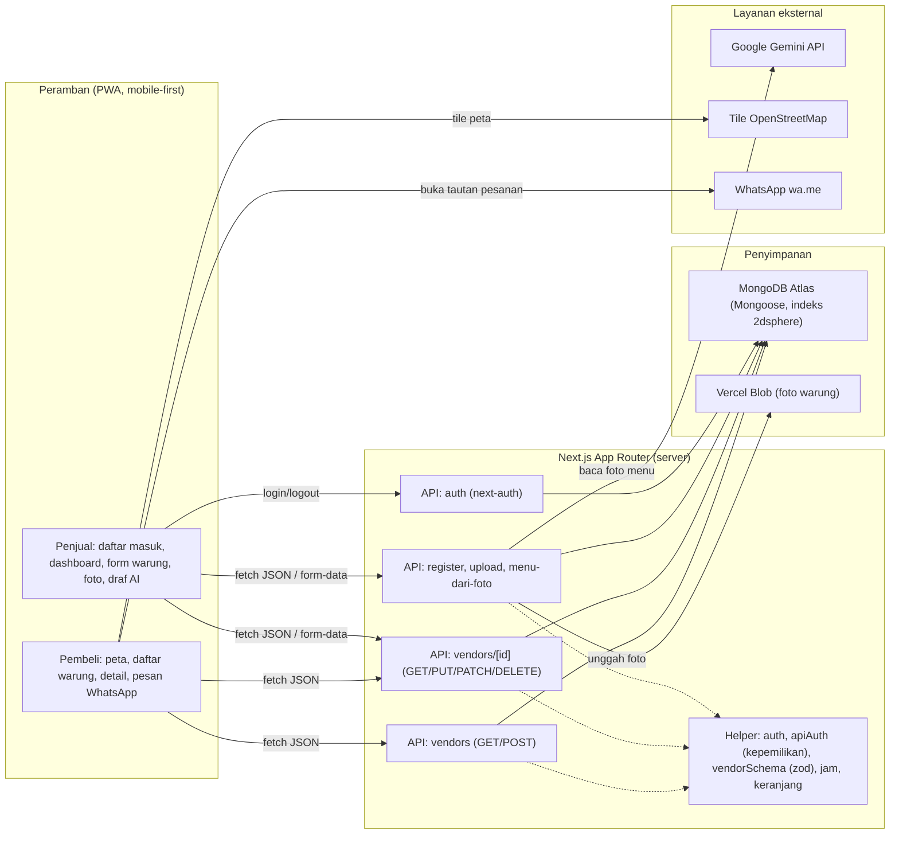
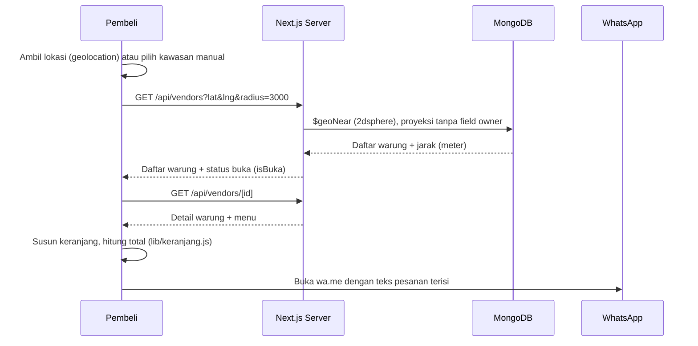
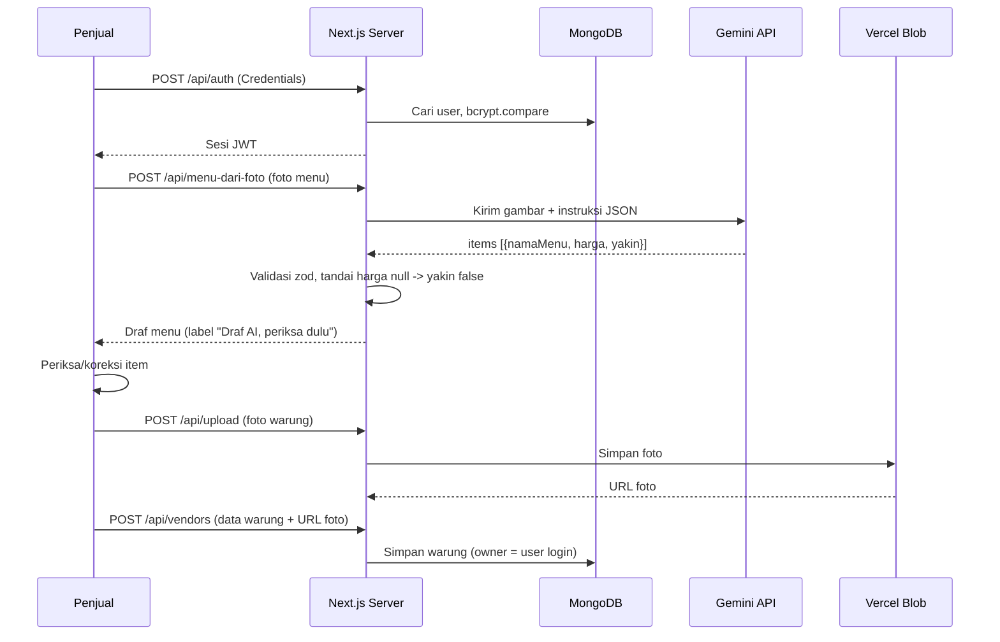

# Cari Jajan

Etalase hiperlokal UMKM: pembeli menemukan warung terdekat di peta dan memesan lewat WhatsApp.
Tidak ada komisi dan tidak ada pembayaran di dalam aplikasi.

## 1. Tim

- **Nama tim:** [ISI]
- **Anggota:**
  - [ISI]
  - [ISI]
  - [ISI]

## 2. Identitas Proyek

- **Kategori lomba:** Web
- **Nama aplikasi:** Cari Jajan
- **Tautan deployment:** [ISI URL]
- **Masalah yang diangkat:** UMKM mikro (warung, PKL, kafe) sulit ditemukan pembeli di sekitarnya.
  Informasi lokasi dan menu tersebar, tidak ada katalog sederhana yang bisa langsung dipakai untuk memesan.
- **Target pengguna:** penjual UMKM mikro dan pembeli di lingkungan sekitar (RT/RW, komplek, area kampus).
- **Deskripsi solusi:** penjual mendaftarkan warung beserta menu dan harga asli, pembeli melihat warung
  terdekat pada peta (OpenStreetMap) lalu memesan langsung via WhatsApp tanpa perantara dan tanpa komisi.

## 3. Fitur Utama yang Sudah Berjalan

Pembeli (tanpa login):

- Deteksi lokasi lewat `navigator.geolocation`; bila izin ditolak atau gagal, tersedia pilihan kawasan manual.
- Peta interaktif (Leaflet + OpenStreetMap) berisi marker warung dan lokasi pembeli.
- Daftar warung terdekat dalam radius 3 km, diurutkan dari yang paling dekat, dengan penanda "Buka"/"Tutup"
  dan jarak dalam meter/kilometer.
- Halaman detail warung: daftar menu dan harga, tombol tambah/kurang, total dihitung otomatis, opsi
  "diantar" atau "ambil sendiri" mengikuti data `layananAntar`.
- Tombol "Pesan via WhatsApp" membuka `wa.me/<nomor>` dengan teks pesanan yang sudah terisi (ter-encode).

Penjual (login):

- Pendaftaran akun (nama, email, password minimal 8 karakter) dengan validasi zod dan hash password bcrypt.
- Masuk lewat next-auth v4 (Credentials, strategi JWT).
- Dashboard berisi daftar warung milik penjual sendiri.
- Tambah dan edit warung: nama, kategori (warung/PKL/kafe), patokan alamat, jam buka/tutup, nomor WhatsApp
  (dinormalisasi ke format `62xxxxxxxxxx`), layanan antar, dan daftar menu dinamis (tambah/hapus baris).
- Pin lokasi pada peta yang bisa digeser, plus tombol "Gunakan lokasiku".
- Foto warung (opsional) dari kamera/galeri: dikompres di sisi klien (sisi terpanjang 1280 px, JPEG kualitas 0.8),
  diunggah ke Vercel Blob, dan hanya URL-nya yang disimpan.
- Foto menu: tombol "Baca menu dari foto" memakai AI untuk membuat draf menu, ditandai "Draf AI, periksa dulu",
  item yang tidak yakin disorot. Foto menu tidak diunggah dan tidak disimpan.
- Kepemilikan warung diperiksa di server: penjual hanya bisa mengubah/menghapus warung miliknya sendiri.
- Logout.

Lain-lain:

- PWA minimal (manifest + ikon) sehingga bisa "Add to Home Screen".
- Koordinat disimpan sebagai GeoJSON `[lng, lat]` dengan indeks `2dsphere`; pencarian terdekat memakai `$geoNear`.
- Tes unit Vitest untuk keranjang, jam operasional, dan normalisasi nomor WhatsApp.

## Rencana Pengembangan

Fitur yang belum selesai dan belum ada di kode:

- Tombol hapus warung di dashboard (endpoint `DELETE` sudah ada, tombol di UI belum dibuat).
- Riwayat/notifikasi pesanan (saat ini pemesanan terjadi di WhatsApp, tidak ada tracking di aplikasi).
- Service worker / dukungan offline (PWA saat ini hanya manifest dan ikon).
- Pencarian dan filter warung berdasarkan kategori atau kata kunci.
- Rating dan ulasan pembeli.
- Perluasan fitur AI selain pembacaan foto menu.

## 4. Teknologi

Framework dan bahasa:

- Next.js 16 (App Router, JavaScript) — MIT
- React 19 / React DOM 19 — MIT

UI dan peta:

- Tailwind CSS 4 (`@tailwindcss/turbopack`) — MIT
- Leaflet — BSD-2-Clause
- react-leaflet — Hippocratic-2.1 (dengan atribusi OpenStreetMap)

Database dan autentikasi:

- MongoDB Atlas via Mongoose 9 — MIT
- next-auth v4 (Credentials, strategi JWT) — ISC
- bcryptjs — BSD-3-Clause

Validasi dan pengujian:

- zod 4 — MIT
- Vitest 5 — MIT
- ESLint 9 + eslint-config-next — MIT

API dan layanan pihak ketiga:

- Google Gemini API (pembacaan foto menu menjadi draf) — dipanggil dari server
- Vercel Blob (`@vercel/blob`, Apache-2.0) — penyimpanan foto warung
- Tile peta OpenStreetMap — data © kontributor OpenStreetMap (ODbL)
- WhatsApp `wa.me` — tautan pesan (bukan API berbayar)

## 5. Arsitektur Sistem



Alur data pemesanan pembeli:



Alur data penjual (termasuk AI draf menu):



## 6. Instalasi, Konfigurasi, dan Menjalankan

Prasyarat: Node.js 20+ dan akses ke MongoDB Atlas, Google Gemini API, serta Vercel Blob.

```bash
npm install
```

Buat file `.env.local` di root (jangan commit; sudah masuk `.gitignore`) dan isi variabel dari `.env.example`:

```env
MONGODB_URI=
NEXTAUTH_SECRET=
NEXTAUTH_URL=
GEMINI_API_KEY=
GEMINI_MODEL=
BLOB_READ_WRITE_TOKEN=
DEMO_EMAIL=
DEMO_PASSWORD=
```

Keterangan singkat:

- `MONGODB_URI` — string koneksi MongoDB Atlas.
- `NEXTAUTH_SECRET` — string acak untuk menandatangani sesi JWT.
- `NEXTAUTH_URL` — URL aplikasi (mis. `http://localhost:3000` saat lokal).
- `GEMINI_API_KEY`, `GEMINI_MODEL` — kredensial dan nama model untuk pembacaan foto menu.
- `BLOB_READ_WRITE_TOKEN` — token Vercel Blob untuk mengunggah foto warung.
- `DEMO_EMAIL`, `DEMO_PASSWORD` — akun demo yang dibuat oleh perintah seed.

Isi data contoh (opsional, butuh `MONGODB_URI`, `DEMO_EMAIL`, `DEMO_PASSWORD`):

```bash
npm run seed
```

Menjalankan aplikasi:

```bash
npm run dev      # mode pengembangan
npm run build    # build produksi
npm start        # jalankan hasil build
npm run lint     # periksa gaya kode
npm test         # tes unit Vitest
```

## 7. Akun Demo

- **Email:** [ISI EMAIL DEMO]
- **Password:** [ISI PASSWORD DEMO]

Akun ini dibuat oleh `npm run seed` menggunakan nilai `DEMO_EMAIL` dan `DEMO_PASSWORD` dari environment.

## 8. Dokumentasi Penggunaan AI

### a. AI di dalam aplikasi

- **Layanan/model:** Google Gemini API. Nama model diambil dari environment variable `GEMINI_MODEL`
  (tidak ditulis di kode).
- **Bagian produk yang memakai:** tombol "Baca menu dari foto" pada form tambah/edit warung
  (`POST /api/menu-dari-foto`). Server mengirim foto menu ke Gemini dan menerima `{ items: [{ namaMenu, harga, yakin }] }`.
- **Batas dan etika:** model diinstruksikan membaca hanya teks yang benar-benar terlihat dan tidak menebak harga;
  balasan divalidasi dengan zod, harga yang tidak terbaca diset `null` dengan `yakin:false`.
- **Status hasil:** hasil AI adalah **draf** yang wajib diperiksa penjual. Item yang tidak yakin disorot, dan
  draf tidak pernah disimpan tanpa koreksi dan persetujuan penjual. Foto menu tidak disimpan di server maupun database.
- Pemakaian dibatasi (rate limit per pengguna) agar kuota API aman.

### b. Asisten coding AI selama pengembangan

- **Alat dan model:** [ISI NAMA ALAT DAN MODEL]

## 9. Etika dan Keamanan

- **Disimpan:** akun penjual (nama, email, password ter-hash, waktu daftar), data warung (nama, kategori,
  lokasi GeoJSON, patokan alamat, jam buka/tutup, nomor WhatsApp, menu), dan URL foto warung.
- **Tidak disimpan:** lokasi pembeli, keranjang/keranjang belanja pembeli, dan foto menu untuk AI
  (dipakai hanya untuk draf lalu tidak disimpan di server maupun database).
- **Password** selalu di-hash dengan bcryptjs; tidak pernah disimpan dalam bentuk asli.
- **Kredensial dan kunci** hanya lewat environment variable (`process.env.*`), tidak ditulis di kode. Nama
  variabel didaftarkan di `.env.example` tanpa nilai, sedangkan `.env.local`/`.env*` diabaikan oleh git.
- Semua input dari klien divalidasi dengan zod di server. Endpoint tulis hanya untuk pengguna yang login,
  dan kepemilikan warung dicek di server (bukan di klien).
- Tidak ada komisi dan tidak ada pembayaran di dalam aplikasi.

## 10. Atribusi

- Data peta: **© kontributor OpenStreetMap**, tersedia di bawah ODbL. Atribusi ditampilkan pada setiap peta.
- **Leaflet** — BSD-2-Clause
- **react-leaflet** — Hippocratic-2.1
- **Next.js** — MIT
- **React / React DOM** — MIT
- **Mongoose** — MIT
- **next-auth** — ISC
- **bcryptjs** — BSD-3-Clause
- **zod** — MIT
- **@vercel/blob** — Apache-2.0
- **Tailwind CSS** — MIT
- **Vitest** — MIT
