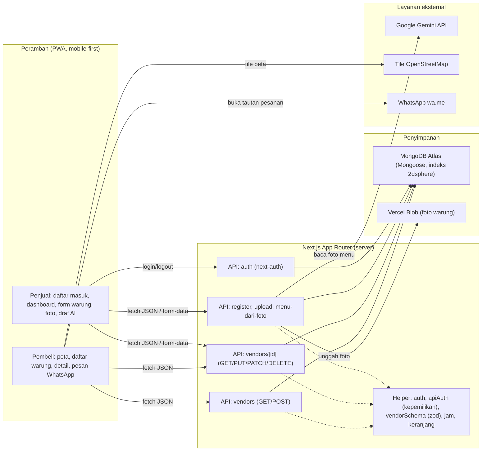
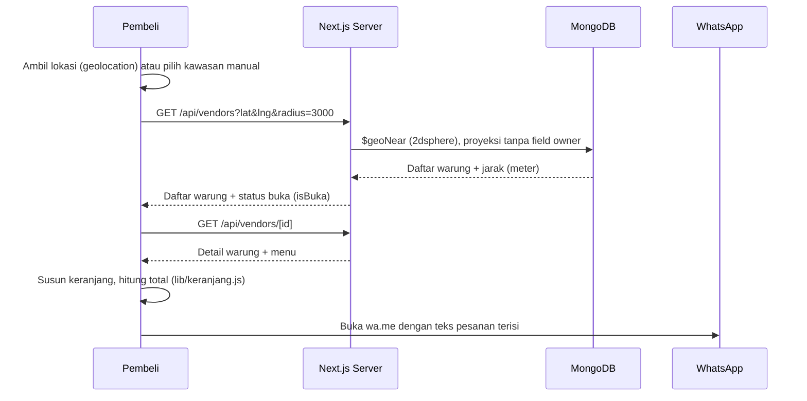
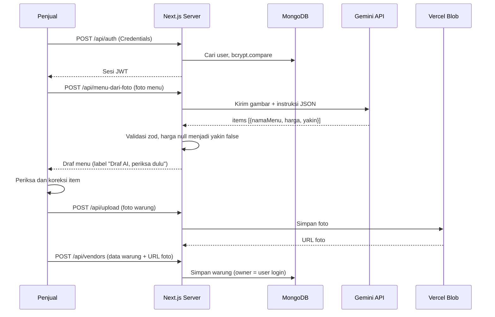

# Cari Jajan

Etalase hiperlokal UMKM — pembeli menemukan warung terdekat di peta dan memesan langsung lewat
WhatsApp. Tanpa komisi, tanpa pembayaran di dalam aplikasi.

> Kategori lomba: **Web** · Subtema: **Local MSME**

## Daftar Isi

1. [Tim](#1-tim)
2. [Pernyataan dan Komitmen](#2-pernyataan-dan-komitmen)
3. [Identitas Proyek](#3-identitas-proyek)
4. [Fitur Utama yang Sudah Berjalan](#4-fitur-utama-yang-sudah-berjalan)
5. [Rencana Pengembangan](#5-rencana-pengembangan)
6. [Teknologi](#6-teknologi)
7. [Arsitektur Sistem](#7-arsitektur-sistem)
8. [Referensi API](#8-referensi-api)
9. [Struktur Proyek](#9-struktur-proyek)
10. [Instalasi dan Menjalankan](#10-instalasi-dan-menjalankan)
11. [Variabel Lingkungan](#11-variabel-lingkungan)
12. [Akun Demo](#12-akun-demo)
13. [Dokumentasi Penggunaan AI](#13-dokumentasi-penggunaan-ai)
14. [Etika dan Keamanan](#14-etika-dan-keamanan)
15. [Atribusi](#15-atribusi)

## 1. Tim

- **Nama tim:** [nama team]
- **Anggota:**
  - [Nico]
  - [Zam Zam]
  - [Farel]
  - [Iwan]

## 2. Pernyataan dan Komitmen

Kami yang bertanda tangan di bawah ini menyatakan dengan sebenar-benarnya, serta bertanggung jawab secara hukum dan akademik, bahwa:

1. **Orisinalitas dan Kepengarangan:** Karya yang diajukan merupakan hasil pemikiran, perancangan, dan pengembangan asli oleh penulis. Karya ini tidak menyalin, menjiplak, menerjemahkan, atau mengadaptasi karya pihak lain tanpa mencantumkan sumber secara tepat.
2. **Hak Kekayaan Intelektual:** Karya ini tidak melanggar hak cipta, paten, merek, rahasia dagang, maupun hak kepemilikan pihak lain. Seluruh literatur, gambar, kode, dan dataset yang digunakan telah dicantumkan sumbernya sesuai kaidah akademik.
3. **Eksklusivitas Pengajuan:** Karya ini belum pernah dipublikasikan dalam jurnal atau prosiding, tidak sedang dan belum pernah diikutsertakan, memperoleh penghargaan, atau dalam proses penilaian pada kompetisi nasional maupun internasional lainnya.
4. **Keaslian Data dan Temuan:** Data empiris, hasil eksperimen, tanggapan survei, kode, serta demonstrasi prototipe yang disertakan merupakan data dan hasil yang autentik, akurat, diperoleh secara etis, serta bebas dari fabrikasi dan falsifikasi.
5. **Penggunaan Kecerdasan Artifisial:** Penggunaan perangkat kecerdasan artifisial (AI) dalam penelitian atau penyusunan draf telah mematuhi ketentuan resmi kompetisi dan diungkapkan secara transparan. Gagasan inti, analisis kritis, dan keluaran intelektual tetap merupakan hasil karya manusia.
6. **Konsekuensi Pelanggaran:** Kami memahami bahwa pelanggaran terhadap pernyataan ini dapat mengakibatkan diskualifikasi, pencabutan penghargaan atau sertifikat, serta pelaporan kepada universitas untuk proses penegakan disiplin akademik.
7. **Kepatuhan Alur Kompetisi:** Kami bersedia mengikuti alur kompetisi yang diberikan oleh panitia dari awal hingga akhir kompetisi.

## 3. Identitas Proyek

| | |
|---|---|
| **Kategori** | Web |
| **Nama aplikasi** | Cari Jajan |
| **Tautan deployment** | [ISI URL] |
| **Target pengguna** | Penjual UMKM mikro dan pembeli di lingkungan sekitar (RT/RW, komplek, area kampus) |

**Masalah yang diangkat.** UMKM mikro — warung, PKL, dan kafe — sulit ditemukan pembeli di sekitarnya.
Informasi lokasi dan menu tersebar dan tidak ada katalog sederhana yang bisa langsung dipakai untuk memesan.

**Deskripsi solusi.** Penjual mendaftarkan warung beserta menu dan harga asli. Pembeli melihat warung
terdekat pada peta OpenStreetMap, menyusun pesanan, lalu mengirimnya lewat WhatsApp tanpa perantara,
tanpa komisi, dan tanpa pembayaran di dalam aplikasi.

## 4. Fitur Utama yang Sudah Berjalan

### A. Pembeli & Kontributor Komunitas
- **Deteksi Lokasi & Pencarian Terdekat:** Deteksi GPS real-time dengan kompas arah hadap. Bila GPS tidak aktif, tersedia pilihan kawasan manual.
- **Peta Interaktif:** Peta vektor modern (MapLibre + OpenFreeMap Liberty) dengan marker kategori warung kustom (rumah, gerobak PKL, motor keliling).
- **Rute & Navigasi GPS Turn-by-Turn:** Kalkulasi jalur jalan raya riil via OSRM, estimasi durasi (motor & jalan kaki), serta tombol navigasi langsung ke Google Maps dengan panduan suara.
- **Pencarian & Filter Kategori:** Filter chip warung (Semua, Warung, PKL, Rumah Makan, Cafe, Keliling) dan live search bar.
- **Daftar Warung Terdekat:** Menampilkan warung terdekat dalam radius dengan penanda status Buka/Tutup dan jarak riil.
- **Halaman Detail Warung & Pesanan WhatsApp:** Katalog menu, kalkulasi total otomatis, opsi pesan diantar / ambil sendiri, serta tautan langsung ke WhatsApp penjual tanpa potongan komisi.
- **Kontribusi Titik Warung Baru (Crowdsourced):** Pembeli dapat mengajukan titik lokasi warung UMKM tersembunyi yang baru mereka temukan untuk dikurasi admin.
- **Gamifikasi Kontributor (Level & XP):** Sistem reward +50 XP per warung yang lolos kurasi admin, progress bar XP, dan gelar kehormatan kontributor (*Penjelajah Jajanan*, *Pemberi Rekomendasi*, *Pahlawan UMKM Lokal*).

### B. Pemilik Warung (Penjual)
- **Pendaftaran & Autentikasi:** Masuk dan buat akun dengan validasi Zod dan enkripsi password bcrypt.
- **Dashboard Performa Warung:**
  - **Statistik Pengunjung:** Menampilkan total dilihat pembeli (*view count*) dan frekuensi warung masuk radar pencarian radius pembeli.
  - **Status Kurasi Admin:** Tampilan status verifikasi awal (*Menunggu Kurasi Admin* atau *Terverifikasi & Tayang*).
- **Fitur Khusus "Zero Waste Food" (Penyelamat Makanan UMKM):**
  - Sesuai pilar SDG 12 (*Responsible Consumption*), penjual dapat mengaktifkan promo diskon makanan berlebih jelang tutup (diskon 20%, 30%, 50%) agar dagangan cepat habis dan mencegah makanan terbuang sia-sia.
- **Pengelolaan Warung & Menu:** Menambah, mengedit nama, patokan alamat, jam buka-tutup, nomor WhatsApp, foto, dan daftar menu dinamis.
- **Draf Menu dari AI:** Tombol "Baca menu dari foto" berbasis AI (Google Gemini API) untuk mengekstrak menu dan harga dari foto daftar menu secara otomatis dengan label wajib *"Draf AI, periksa dulu"*.
- **Keamanan Data Server-Side:** Validasi kepemilikan warung ketat di server; penjual hanya bisa mengubah warung miliknya sendiri.

### C. Kurasi & Admin
- **Halaman Kurasi Admin:** Tinjauan warung baru yang didaftarkan penjual maupun diajukan pembeli sebelum ditayangkan ke publik.
- **Distribusi XP Otomatis:** Pemberian +50 XP secara otomatis ke akun pengaju saat warung disetujui (*approved*).

### D. Multi-Platform
- **Web App / PWA:** Mobile-first, responsif, dan ringan berbasis Next.js App Router & Tailwind CSS.
- **Aplikasi Native Android:** 100% Kotlin murni + Jetpack Compose tanpa WebView wrapper, terhubung langsung ke backend REST API.

## 5. Rencana Pengembangan

Fitur yang direncanakan untuk iterasi berikutnya:

- Riwayat pemesanan terpusat (arsip ringkasan order lokal).
- Sistem rating bintang dan ulasan kurasi pembeli.
- Notifikasi push Firebase saat ada promo Zero Waste Food aktif di sekitar pengguna.
- Mode peta luring (offline caching tile wilayah terpilih).

## 6. Teknologi

| Lapisan | Teknologi | Lisensi |
|---|---|---|
| Web Framework | Next.js 16 (App Router), React 19 / React DOM 19 | MIT |
| Mobile Native | Android (Kotlin, Jetpack Compose, Coroutines, Flow) | Apache-2.0 |
| UI Styling | Tailwind CSS 4 (`@tailwindcss/turbopack`), Material Design 3 | MIT / Apache-2.0 |
| Peta & Tile | MapLibre GL, react-map-gl, OpenFreeMap Liberty | BSD-3-Clause, 3-Clause BSD |
| Data Peta | OpenStreetMap | ODbL |
| Navigasi & Routing | OSRM (Open Source Routing Machine), Android Navigation Intent | BSD-2-Clause |
| Database | MongoDB Atlas via Mongoose 9 (Indeks 2dsphere Spasial) | MIT |
| Autentikasi | next-auth v4 (Credentials, JWT), bcryptjs | ISC, BSD-3-Clause |
| Validasi | Zod 4 | MIT |
| Pengujian | Vitest 5, ESLint 9 + eslint-config-next | MIT |
| AI | Google Gemini API (dipanggil dari server) | — |
| Penyimpanan Berkas | Vercel Blob (`@vercel/blob`) | Apache-2.0 |
| Pesan | WhatsApp `wa.me` (protokol deep link) | — |

## 7. Arsitektur Sistem



### Alur data pembeli



### Alur data penjual (termasuk draf menu AI)



## 8. Referensi API

Semua endpoint menerima/mengembalikan JSON, kecuali yang ber-tanda form-data.

| Metode | Path | Akses | Keterangan |
|---|---|---|---|
| GET | `/api/vendors` | Publik | Warung terdekat via `$geoNear`; parameter `lat`, `lng`, `radius` (meter, default 2000, maks 10000) |
| POST | `/api/vendors` | Login | Buat warung baru (status `pending`, menunggu kurasi admin), `owner` & `submittedBy` dari sesi |
| GET | `/api/vendors/[id]` | Publik | Detail satu warung (tanpa data owner) |
| PUT | `/api/vendors/[id]` | Login + pemilik | Perbarui warung |
| PATCH | `/api/vendors/[id]` | Login + pemilik | Perbarui sebagian warung (alias PUT) |
| DELETE | `/api/vendors/[id]` | Login + pemilik | Hapus warung |
| GET | `/api/vendors/mine` | Login | Daftar warung yang dimiliki/diajukan oleh pengguna yang sedang login |
| POST | `/api/register` | Publik | Daftar akun pengguna/penjual (nama, email, password) |
| POST | `/api/login` | Publik | Masuk dengan email & password, mengembalikan token JWT dan data user |
| GET | `/api/session` | Login | Ambil profil pengguna aktif (termasuk status XP dan level gamifikasi) |
| POST | `/api/upload` | Login | Unggah foto warung (form-data, maks 2 MB) ke Vercel Blob |
| POST | `/api/menu-dari-foto` | Login | Draf menu dari foto via Gemini (form-data, maks 2 MB, ada rate limit) |
| GET | `/api/admin/vendors` | Admin | Daftar seluruh warung untuk keperluan kurasi verifikasi |
| PATCH | `/api/admin/vendors/[id]` | Admin | Setujui (*approve*) atau tolak (*reject*) warung; otomatis menambahkan +50 XP ke pengaju |

## 9. Struktur Proyek

```
app/                          Next.js App Router (Halaman web responsif & route API)
  api/                        Handler REST API (auth, vendors, admin, upload, menu-dari-foto)
  admin/kurasi/               Halaman kurasi verifikasi warung oleh admin
  dashboard/                  Dashboard pengelolaan warung & gamifikasi web
  warung/[id]/                Detail warung & keranjang pemesanan WhatsApp
components/                   Komponen UI web (Peta, Formulir, Foto, Badge Kategori)
lib/                          Utilitas (auth, apiAuth, mongodb, gamifikasi, vendorSchema, jam)
models/                       Mongoose Schema (User dengan XP/Level, Vendor dengan kurasi status)
native-android/               Aplikasi Native Android (100% Kotlin + Jetpack Compose)
  app/src/main/java/com/carijajan/app/
    data/                     ApiClient, ApiService, AuthRepository, VendorRepository, TokenStore
    ui/screen/                BerandaScreen, DashboardScreen, MasukScreen, DaftarScreen, EditWarungScreen, WarungDetailScreen
    ui/components/            PetaWarung (MapLibre), PinGenerator (Dynamic Vector Pin & Heading Puck), KomponenFoto
    util/                     ArahKompas, Navigasi (OSRM & GPS Intent), Gamifikasi, Lokasi, WhatsApp
scripts/                      seed.js (data awal), migrasi-kurasi.js, set-role.js
tests/                        Tes unit Vitest (gamifikasi, jam operasional, keranjang, nomor WA)
public/                       Aset ikon, manifest PWA, service worker
```

## 10. Instalasi dan Menjalankan

Prasyarat: Node.js 20+, database MongoDB Atlas, kunci Google Gemini API, dan token Vercel Blob.

```bash
npm install
```

Buat `.env.local` di root (diabaikan git) dan isi variabel. Lihat [Variabel Lingkungan](#11-variabel-lingkungan).

Isi data contoh (opsional; butuh `MONGODB_URI`, `DEMO_EMAIL`, `DEMO_PASSWORD`):

```bash
npm run seed
```

Perintah yang tersedia:

| Perintah | Fungsi |
|---|---|
| `npm run dev` | Jalankan server web mode pengembangan |
| `npm run build` | Build produksi Next.js |
| `npm start` | Jalankan hasil build produksi |
| `npm run lint` | Periksa gaya kode ESLint |
| `npm test` | Jalankan rangkaian tes unit Vitest |
| `npm run seed` | Isi akun demo + warung contoh di Jember |

Untuk menjalankan aplikasi Native Android:
Buka folder `native-android/` di Android Studio (Koala/Ladybug atau lebih baru) atau jalankan:
```bash
cd native-android
./gradlew assembleDebug
```

## 11. Variabel Lingkungan

Buat berkas `.env.local` (jangan di-commit; sudah ada di `.gitignore`) dan isi nama variabel berikut sesuai `.env.example`:

```env
MONGODB_URI=
NEXTAUTH_SECRET=
NEXTAUTH_URL=
GEMINI_API_KEY=
GEMINI_MODEL=
BLOB_READ_WRITE_TOKEN=
DEMO_EMAIL=
DEMO_PASSWORD=
NEXT_PUBLIC_MAP_STYLE_URL=
```

| Variabel | Keterangan |
|---|---|
| `MONGODB_URI` | String koneksi database MongoDB Atlas |
| `NEXTAUTH_SECRET` | String acak untuk menandatangani sesi JWT |
| `NEXTAUTH_URL` | URL aplikasi web (mis. `http://localhost:3000` saat pengujian lokal) |
| `GEMINI_API_KEY` | Kunci Google Gemini API untuk fitur ekstrak draf menu |
| `GEMINI_MODEL` | Nama model Gemini (misalnya `gemini-1.5-flash`, tidak ditulis langsung di kode) |
| `BLOB_READ_WRITE_TOKEN` | Token Vercel Blob untuk penyimpanan foto warung |
| `DEMO_EMAIL` | Email akun demo untuk `npm run seed` |
| `DEMO_PASSWORD` | Password akun demo untuk `npm run seed` |
| `NEXT_PUBLIC_MAP_STYLE_URL` | URL style vector tile (default: OpenFreeMap Liberty) |

## 12. Akun Demo

- **Email:** `demo@carijajan.local`
- **Password:** `Demo1234!`

Dapat diisi ulang sewaktu-waktu menggunakan perintah `npm run seed`.

## 13. Dokumentasi Penggunaan AI

### a. AI di dalam aplikasi

- **Layanan/model:** Google Gemini API. Nama model diambil dari environment `GEMINI_MODEL`, tidak ditulis langsung di kode program.
- **Bagian produk yang memakai:** tombol "Baca menu dari foto" pada formulir tambah/edit warung (`POST /api/menu-dari-foto`). Server mengirim gambar foto menu ke Gemini dan menerima struktur data `{ items: [{ namaMenu, harga, yakin }] }`.
- **Batas dan etika:** model diinstruksikan membaca hanya teks yang benar-benar terlihat dan tidak menebak harga. Hasil divalidasi oleh Zod di server; harga yang tidak terbaca diset `null` dengan status `yakin: false`.
- **Status hasil:** hasil AI berlabel tegas **"Draf AI, periksa dulu"**. Draf tidak pernah disimpan ke database tanpa pemeriksaan, koreksi, dan persetujuan pengguna. Berkas foto menu sementara tidak disimpan di server maupun database.
- Terdapat pembatasan laju (*rate limiting*) per pengguna agar pemakaian aman dan bertanggung jawab.

### b. Asisten coding AI selama pengembangan

- **Alat dan model:** **OpenCode** dan **Google Antigravity** (dengan model Gemini 3.8 Flash High) digunakan secara transparan sebagai *coding assistant* untuk scaffolding arsitektur, refaktorisasi komponen Jetpack Compose, pengujian unit test Vitest, pembuatan draf dokumentasi, dan integrasi MapLibre SDK. Seluruh keputusan desain arsitektur, logika bisnis, dan kepengarangan tetap sepenuhnya di bawah arahan dan kendali pengembang manusia.

## 14. Etika dan Keamanan

- **Data yang disimpan:** akun pengguna (nama, email, hash password bcrypt, tanggal dibuat, XP/Level), data warung (nama, kategori, koordinat spasial GeoJSON, patokan alamat, jam buka-tutup, nomor WhatsApp, daftar menu), serta URL foto warung.
- **Data yang TIDAK disimpan:** lokasi GPS pembeli (hanya diproses di memori perangkat klien), isi keranjang pembeli, dan berkas foto menu pembacaan AI.
- **Password:** selalu di-hash menggunakan `bcryptjs` (salt rounds 10); tidak pernah disimpan atau dicatat dalam bentuk teks asli.
- **Kredensial dan Kunci Rahasia:** selalu diakses melalui `process.env.*`. Seluruh nama variabel wajib didaftarkan di `.env.example` tanpa nilai asli. Berkas `.env*` dan `.env.local` diabaikan oleh Git.
- **Validasi Berlapis di Sisi Server:** setiap input klien divalidasi menggunakan skema Zod di backend Next.js sebelum menyentuh basis data.
- **Otorisasi & Kurasi:** pemeriksaan kepemilikan warung dilakukan di server. Warung yang diajukan melewati kurasi admin sebelum ditayangkan.
- **Tanpa Monopolistik Finansial:** tidak ada komisi, biaya potongan merchant, maupun pemrosesan transaksi dalam aplikasi. Pembeli dan UMKM bertransaksi langsung secara bebas via WhatsApp.

## 15. Atribusi

- **Data Peta:** © kontributor [OpenStreetMap](https://www.openstreetmap.org/copyright), tersedia di bawah lisensi Open Database License (ODbL). Atribusi wajib selalu ditampilkan pada setiap tampilan peta.
- **Tile Peta Vektor:** [OpenFreeMap](https://openfreemap.org/) (Liberty Style)
- **Mesin Routing & Navigasi:** [OSRM (Open Source Routing Machine)](https://project-osrm.org/)
- **SDK Peta Mobile:** [MapLibre Native Android](https://maplibre.org/) — 3-Clause BSD License
- **Framework & Runtime:** [Next.js](https://nextjs.org/) (MIT) · [React](https://react.dev/) (MIT) · Android Jetpack (Apache-2.0)
- **Basis Data & ORM:** [MongoDB](https://www.mongodb.com/) · [Mongoose](https://mongoosejs.com/) (MIT)
- **Autentikasi & Keamanan:** [NextAuth.js](https://next-auth.js.org/) (ISC) · [bcryptjs](https://github.com/dcodeIO/bcrypt.js) (BSD-3-Clause)
- **Validasi Data:** [Zod](https://zod.dev/) (MIT)
- **Penyimpanan Objek:** [Vercel Blob](https://vercel.com/docs/storage/vercel-blob) (Apache-2.0)
- **Styling UI:** [Tailwind CSS](https://tailwindcss.com/) (MIT) · Material Design 3 (Apache-2.0)
- **Framework Pengujian:** [Vitest](https://vitest.dev/) (MIT)
