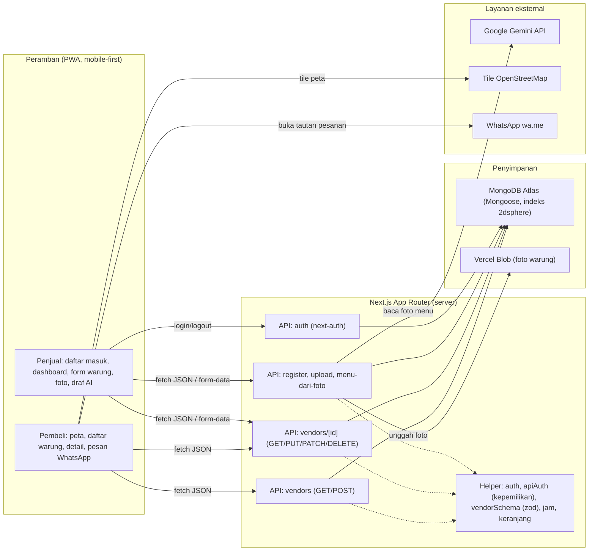
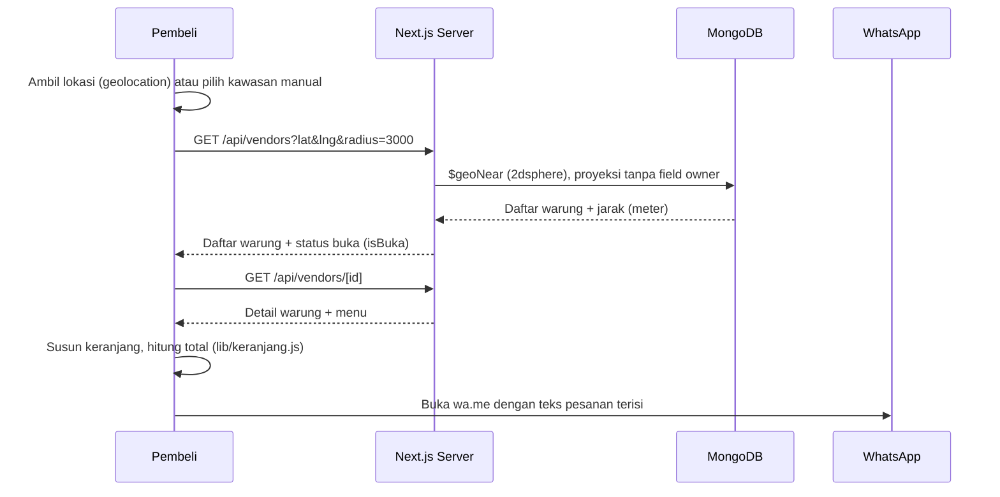
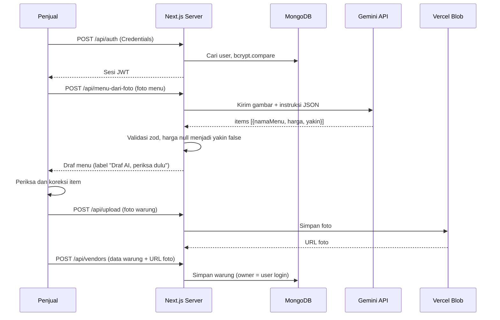

# Cari Jajan

Etalase hiperlokal UMKM — pembeli menemukan warung terdekat di peta dan memesan langsung lewat
WhatsApp. Tanpa komisi, tanpa pembayaran di dalam aplikasi.

> Kategori lomba: **Web** · Subtema: **Local MSME**

## Daftar Isi

1. [Tim](#1-tim)
2. [Identitas Proyek](#2-identitas-proyek)
3. [Fitur Utama yang Sudah Berjalan](#3-fitur-utama-yang-sudah-berjalan)
4. [Rencana Pengembangan](#4-rencana-pengembangan)
5. [Teknologi](#5-teknologi)
6. [Arsitektur Sistem](#6-arsitektur-sistem)
7. [Referensi API](#7-referensi-api)
8. [Struktur Proyek](#8-struktur-proyek)
9. [Instalasi dan Menjalankan](#9-instalasi-dan-menjalankan)
10. [Variabel Lingkungan](#10-variabel-lingkungan)
11. [Akun Demo](#11-akun-demo)
12. [Dokumentasi Penggunaan AI](#12-dokumentasi-penggunaan-ai)
13. [Etika dan Keamanan](#13-etika-dan-keamanan)
14. [Atribusi](#14-atribusi)

## 1. Tim

- **Nama tim:** [nama team]
- **Anggota:**
  - [Nico]
  - [Zam Zam]
  - [Farel]
  - [Iwan]

## 2. Identitas Proyek

| | |
|---|---|
| **Kategori** | Web |
| **Nama aplikasi** | Cari Jajan |
| **Tautan deployment** | [ISI URL] |
| **Target pengguna** | Penjual UMKM mikro dan pembeli di lingkungan sekitar (RT/RW, komplek, area kampus) |

**Masalah yang diangkat.** UMKM mikro — warung, PKL, dan kafe — sulit ditemukan pembeli di sekitarnya.
Informasi lokasi dan menu tersebar dan tidak ada katalog sederhana yang bisa langsung dipakai untuk memesan.

**Deskripsi solusi.** Penjual mendaftarkan warung beserta menu dan harga asli. Pembeli melihat warung
terdekat pada peta OpenStreetMap, menyusun pesanan, lalu mengirimnya lewat WhatsApp tanpa perantara,
tanpa komisi, dan tanpa pembayaran di dalam aplikasi.

## 3. Fitur Utama yang Sudah Berjalan

### Pembeli (tanpa login)

- **Deteksi lokasi** lewat `navigator.geolocation`; bila izin ditolak atau gagal, tersedia pilihan
  **kawasan manual** sehingga alur tetap bisa dipakai.
- **Peta interaktif** (Leaflet + OpenStreetMap) dengan marker warung dan lokasi pembeli.
- **Daftar warung terdekat** dalam radius 3 km (dapat diatur lewat parameter `radius`), diurutkan dari yang
  paling dekat, lengkap dengan penanda **Buka/Tutup** dan jarak dalam meter/kilometer.
- **Halaman detail warung:** daftar menu dan harga, tombol tambah/kurang, total dihitung otomatis, serta opsi
  **diantar / ambil sendiri** mengikuti data `layananAntar`.
- **Pesan via WhatsApp:** tombol membuka `wa.me/<nomor>` dengan teks pesanan yang sudah terisi dan ter-encode.

### Penjual (login)

- **Pendaftaran akun** (nama, email, password minimal 8 karakter) dengan validasi zod dan hash password bcrypt.
- **Masuk** lewat next-auth v4 (Credentials, strategi JWT).
- **Dashboard** berisi daftar warung milik penjual sendiri, dengan tombol mengambang untuk menambah warung.
- **Tambah dan edit warung:** nama, kategori (warung/PKL/kafe), patokan alamat, jam buka/tutup, nomor WhatsApp
  (dinormalisasi otomatis ke format `62xxxxxxxxxx`), layanan antar, dan daftar menu dinamis (tambah/hapus baris).
- **Pin lokasi** pada peta yang bisa digeser, ditambah tombol "Gunakan lokasiku" untuk mengisi dari GPS.
- **Foto warung** (opsional) dari kamera atau galeri: dikompres di sisi klien (sisi terpanjang 1280 px, JPEG
  kualitas 0.8), diunggah ke Vercel Blob, dan hanya URL-nya yang disimpan.
- **Draf menu dari AI:** tombol "Baca menu dari foto" memakai AI untuk menyusun draf menu, ditandai
  "Draf AI, periksa dulu", dan item yang tidak yakin disorot. Foto menu tidak diunggah dan tidak disimpan.
- **Kepemilikan diperiksa di server:** penjual hanya bisa mengubah/menghapus warung miliknya sendiri.
- **Logout.**

### Lintas aplikasi

- **PWA minimal** (manifest + ikon) sehingga dapat ditambahkan ke Home Screen.
- **Geospasial:** koordinat disimpan sebagai GeoJSON `[lng, lat]` dengan indeks `2dsphere`; pencarian terdekat
  memakai `$geoNear`.
- **Validasi server** seluruh input klien dengan zod.
- **Tes unit** (Vitest) untuk keranjang, jam operasional, dan normalisasi nomor WhatsApp.

## 4. Rencana Pengembangan

Fitur berikut **belum** ada di kode:

- Tombol hapus warung di dashboard (endpoint `DELETE` sudah tersedia, tombol di UI belum dibuat).
- Riwayat/notifikasi pesanan (pemesanan saat ini terjadi di WhatsApp tanpa pelacakan di aplikasi).
- Service worker / dukungan offline (PWA saat ini hanya manifest dan ikon).
- Pencarian dan filter warung berdasarkan kategori atau kata kunci.
- Rating dan ulasan pembeli.
- Perluasan fitur AI selain pembacaan foto menu.

## 5. Teknologi

| Lapisan | Teknologi | Lisensi |
|---|---|---|
| Framework | Next.js 16 (App Router), React 19 / React DOM 19 | MIT |
| UI | Tailwind CSS 4 (`@tailwindcss/turbopack`) | MIT |
| Peta | Leaflet, react-leaflet | BSD-2-Clause, Hippocratic-2.1 |
| Database | MongoDB Atlas via Mongoose 9 | MIT |
| Autentikasi | next-auth v4 (Credentials, JWT), bcryptjs | ISC, BSD-3-Clause |
| Validasi | zod 4 | MIT |
| Pengujian | Vitest 5, ESLint 9 + eslint-config-next | MIT |
| AI | Google Gemini API (dipanggil dari server) | — |
| Penyimpanan berkas | Vercel Blob (`@vercel/blob`) | Apache-2.0 |
| Peta (data) | OpenStreetMap | ODbL |
| Pesan | WhatsApp `wa.me` (tautan, bukan API berbayar) | — |

## 6. Arsitektur Sistem



### Alur data pembeli



### Alur data penjual (termasuk draf menu AI)



## 7. Referensi API

Semua endpoint menerima/mengembalikan JSON, kecuali yang ber-tanda form-data.

| Metode | Path | Akses | Keterangan |
|---|---|---|---|
| GET | `/api/vendors` | Publik | Warung terdekat via `$geoNear`; parameter `lat`, `lng`, `radius` (meter, default 2000, maks 10000) |
| POST | `/api/vendors` | Login | Buat warung baru, `owner` diambil dari sesi |
| GET | `/api/vendors/[id]` | Publik | Detail satu warung (tanpa data owner) |
| PUT | `/api/vendors/[id]` | Login + pemilik | Perbarui warung |
| PATCH | `/api/vendors/[id]` | Login + pemilik | Perbarui sebagian warung (alias PUT) |
| DELETE | `/api/vendors/[id]` | Login + pemilik | Hapus warung |
| POST | `/api/register` | Publik | Daftar akun penjual (nama, email, password) |
| POST | `/api/upload` | Login | Unggah foto warung (form-data, maks 2 MB) ke Vercel Blob |
| POST | `/api/menu-dari-foto` | Login | Draf menu dari foto via Gemini (form-data, maks 2 MB, ada rate limit) |
| GET, POST | `/api/auth/[...nextauth]` | Publik | Endpoint sesi next-auth |

## 8. Struktur Proyek

```
app/
  page.js                     Halaman pembeli (peta + daftar terdekat)
  warung/[id]/page.js         Detail warung + keranjang + pesan WhatsApp
  masuk/page.js               Halaman masuk
  daftar/page.js              Halaman daftar akun
  dashboard/page.js           Daftar warung milik penjual
  dashboard/tambah/page.js    Form tambah warung
  dashboard/edit/[id]/page.js Form edit warung
  api/                        Route handler (auth, vendors, register, upload, menu-dari-foto)
components/                   WarungForm, FotoInput, MapComponent, PinMap, LogoutButton
lib/                          auth, apiAuth, mongodb, vendorSchema, gemini, rateLimit, jam, keranjang
models/                       User, Vendor
scripts/seed.js               Pengisi data contoh
tests/                        Tes unit Vitest
public/manifest.json          Manifest PWA
```

## 9. Instalasi dan Menjalankan

Prasyarat: Node.js 20+, database MongoDB Atlas, kunci Google Gemini API, dan token Vercel Blob.

```bash
npm install
```

Buat `.env.local` di root (diabaikan git) dan isi variabel. Lihat [Variabel Lingkungan](#10-variabel-lingkungan).

Isi data contoh (opsional; butuh `MONGODB_URI`, `DEMO_EMAIL`, `DEMO_PASSWORD`):

```bash
npm run seed
```

Perintah yang tersedia:

| Perintah | Fungsi |
|---|---|
| `npm run dev` | Jalankan mode pengembangan |
| `npm run build` | Build produksi |
| `npm start` | Jalankan hasil build |
| `npm run lint` | Periksa gaya kode |
| `npm test` | Jalankan tes unit Vitest |
| `npm run seed` | Isi akun demo + 5 warung contoh di Jember |

## 10. Variabel Lingkungan

Buat berkas `.env.local` (jangan di-commit; sudah ada di `.gitignore`) dan isi nama variabel berikut
sesuai `.env.example`:

```env
MONGODB_URI=
NEXTAUTH_SECRET=
NEXTAUTH_URL=
GEMINI_API_KEY=
GEMINI_MODEL=
BLOB_READ_WRITE_TOKEN=
DEMO_EMAIL=
DEMO_PASSWORD=
```

| Variabel | Keterangan |
|---|---|
| `MONGODB_URI` | String koneksi MongoDB Atlas |
| `NEXTAUTH_SECRET` | String acak untuk menandatangani sesi JWT |
| `NEXTAUTH_URL` | URL aplikasi (mis. `http://localhost:3000` saat lokal) |
| `GEMINI_API_KEY` | Kunci Google Gemini API |
| `GEMINI_MODEL` | Nama model Gemini (tidak ditulis di kode) |
| `BLOB_READ_WRITE_TOKEN` | Token Vercel Blob untuk mengunggah foto warung |
| `DEMO_EMAIL` | Email akun demo untuk `npm run seed` |
| `DEMO_PASSWORD` | Password akun demo untuk `npm run seed` |

## 11. Akun Demo

- **Email:** [ISI EMAIL DEMO]
- **Password:** [ISI PASSWORD DEMO]

Dibuat oleh `npm run seed` menggunakan nilai `DEMO_EMAIL` dan `DEMO_PASSWORD` dari environment.

## 12. Dokumentasi Penggunaan AI

### a. AI di dalam aplikasi

- **Layanan/model:** Google Gemini API. Nama model diambil dari environment `GEMINI_MODEL`, tidak ditulis di kode.
- **Bagian produk yang memakai:** tombol "Baca menu dari foto" pada form tambah/edit warung
  (`POST /api/menu-dari-foto`). Server mengirim foto menu ke Gemini dan menerima
  `{ items: [{ namaMenu, harga, yakin }] }`.
- **Batas dan etika:** model diinstruksikan membaca hanya teks yang benar-benar terlihat dan tidak menebak harga;
  balasan divalidasi zod, harga yang tidak terbaca diset `null` dengan `yakin:false`.
- **Status hasil:** hasil AI adalah **draf** yang wajib diperiksa penjual. Item yang tidak yakin disorot, dan draf
  tidak pernah disimpan tanpa koreksi dan persetujuan penjual. Foto menu tidak disimpan di server maupun database.
- Pemakaian dibatasi (rate limit per pengguna) agar kuota API aman.

### b. Asisten coding AI selama pengembangan

- **Alat dan model:** [ISI NAMA ALAT DAN MODEL]

## 13. Etika dan Keamanan

- **Disimpan:** akun penjual (nama, email, password ter-hash, waktu daftar), data warung (nama, kategori, lokasi
  GeoJSON, patokan alamat, jam buka/tutup, nomor WhatsApp, menu), dan URL foto warung.
- **Tidak disimpan:** lokasi pembeli, keranjang pembeli, dan foto menu untuk AI (dipakai hanya untuk draf, lalu
  tidak disimpan di server maupun database).
- **Password** selalu di-hash dengan bcryptjs; tidak pernah disimpan dalam bentuk asli.
- **Kredensial dan kunci** hanya lewat environment variable (`process.env.*`). Nama variabel didaftarkan di
  `.env.example` tanpa nilai, sedangkan `.env.local` / `.env*` diabaikan git.
- **Validasi server** seluruh input klien dengan zod. Endpoint tulis hanya untuk pengguna yang login, dan
  kepemilikan warung dicek di server (bukan di klien).
- Tidak ada komisi dan tidak ada pembayaran di dalam aplikasi.

## 14. Atribusi

- Data peta: **© kontributor OpenStreetMap**, tersedia di bawah ODbL. Atribusi ditampilkan pada setiap peta.
- **Leaflet** — BSD-2-Clause · **react-leaflet** — Hippocratic-2.1
- **Next.js** — MIT · **React / React DOM** — MIT
- **Mongoose** — MIT · **next-auth** — ISC · **bcryptjs** — BSD-3-Clause
- **zod** — MIT · **@vercel/blob** — Apache-2.0
- **Tailwind CSS** — MIT · **Vitest** — MIT
