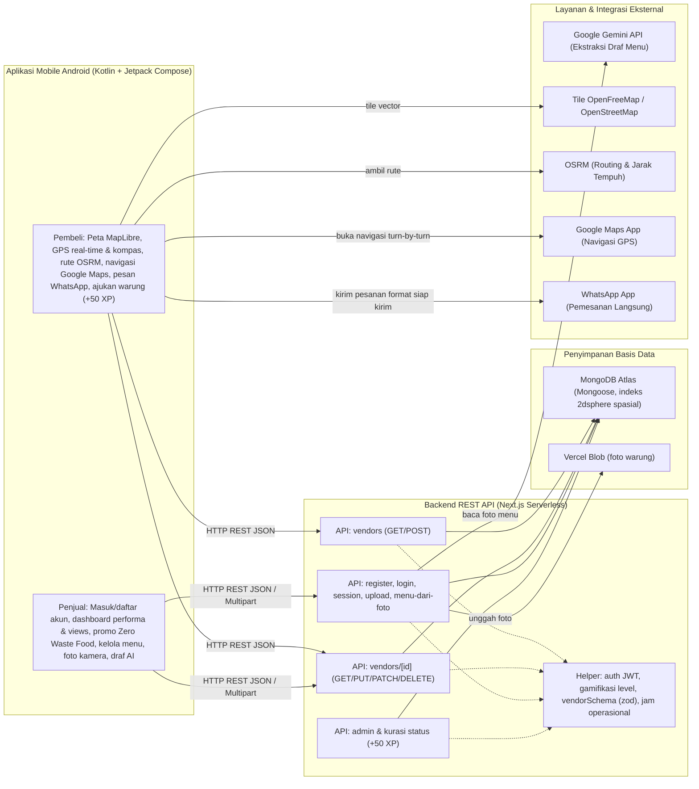
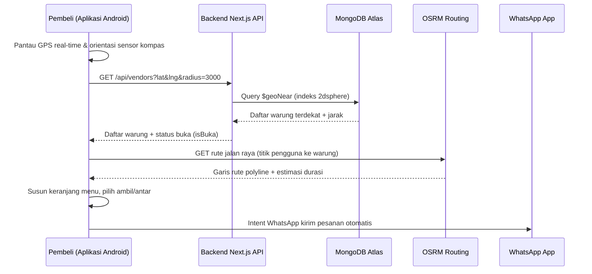
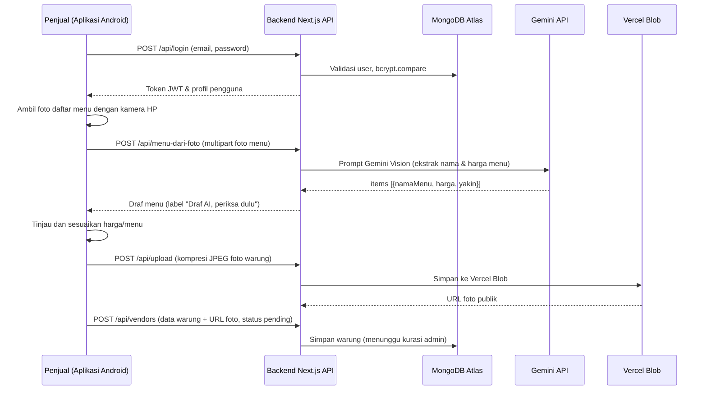

# Cari Jajan

Aplikasi mobile etalase hiperlokal UMKM — memudahkan pencarian warung UMKM terdekat di peta interaktif serta memfasilitasi promosi diskon *Zero Waste Food* agar makanan tidak mubazir bagi UMKM, bernavigasi langsung, dan memesan tanpa perantara lewat WhatsApp. Tanpa komisi, tanpa potongan merchant, dan tanpa pembayaran di dalam aplikasi.

> Kategori lomba: **Mobile Application** · Subtema: **Local MSME**

## Daftar Isi

1. [Tim](#1-tim)
2. [Pernyataan dan Komitmen](#2-pernyataan-dan-komitmen)
3. [Identitas Proyek](#3-identitas-proyek)
4. [Fitur Utama yang Sudah Berjalan](#4-fitur-utama-yang-sudah-berjalan)
5. [Rencana Pengembangan](#5-rencana-pengembangan)
6. [Teknologi](#6-teknologi)
7. [Arsitektur Sistem](#7-arsitektur-sistem)
8. [Referensi API](#8-referensi-api)
9. [Struktur Proyek](#9-struktur-proyek)
10. [Instalasi dan Menjalankan](#10-instalasi-dan-menjalankan)
11. [Variabel Lingkungan](#11-variabel-lingkungan)
12. [Akun Uji Coba Juri & Akun Demo](#12-akun-uji-coba-juri--akun-demo)
13. [Dokumentasi Penggunaan AI](#13-dokumentasi-penggunaan-ai)
14. [Etika dan Keamanan](#14-etika-dan-keamanan)
15. [Atribusi](#15-atribusi)

## 1. Tim

- **Nama tim:** [nama team]
- **Anggota:**
  - [Nico]
  - [Zam Zam]
  - [Farel]
  - [Iwan]

## 2. Pernyataan dan Komitmen

Kami yang bertanda tangan di bawah ini menyatakan dengan sebenar-benarnya, serta bertanggung jawab secara hukum dan akademik, bahwa:

1. **Orisinalitas dan Kepengarangan:** Karya yang diajukan merupakan hasil pemikiran, perancangan, dan pengembangan asli oleh penulis. Karya ini tidak menyalin, menjiplak, menerjemahkan, atau mengadaptasi karya pihak lain tanpa mencantumkan sumber secara tepat.
2. **Hak Kekayaan Intelektual:** Karya ini tidak melanggar hak cipta, paten, merek, rahasia dagang, maupun hak kepemilikan pihak lain. Seluruh literatur, gambar, kode, dan dataset yang digunakan telah dicantumkan sumbernya sesuai kaidah akademik.
3. **Eksklusivitas Pengajuan:** Karya ini belum pernah dipublikasikan dalam jurnal atau prosiding, tidak sedang dan belum pernah diikutsertakan, memperoleh penghargaan, atau dalam proses penilaian pada kompetisi nasional maupun internasional lainnya.
4. **Keaslian Data dan Temuan:** Data empiris, hasil eksperimen, tanggapan survei, kode, serta demonstrasi prototipe yang disertakan merupakan data dan hasil yang autentik, akurat, diperoleh secara etis, serta bebas dari fabrikasi dan falsifikasi.
5. **Penggunaan Kecerdasan Artifisial:** Penggunaan perangkat kecerdasan artifisial (AI) dalam penelitian atau penyusunan draf telah mematuhi ketentuan resmi kompetisi dan diungkapkan secara transparan. Gagasan inti, analisis kritis, dan keluaran intelektual tetap merupakan hasil karya manusia.
6. **Konsekuensi Pelanggaran:** Kami memahami bahwa pelanggaran terhadap pernyataan ini dapat mengakibatkan diskualifikasi, pencabutan penghargaan atau sertifikat, serta pelaporan kepada universitas untuk proses penegakan disiplin akademik.
7. **Kepatuhan Alur Kompetisi:** Kami bersedia mengikuti alur kompetisi yang diberikan oleh panitia dari awal hingga akhir kompetisi.

## 3. Identitas Proyek

| | |
|---|---|
| **Kategori Lomba** | Mobile Application |
| **Nama Aplikasi** | Cari Jajan |
| **Platform** | Android (Native Kotlin + Jetpack Compose) |
| **Tautan Berkas APK** | [Tautan Unduh APK / Rilis GitHub] |
| **Tautan Backend API** | https://web-cari-jajan.vercel.app |
| **Target Pengguna** | Pelaku UMKM mikro (warung makan, pedagang kaki lima/PKL, penjual keliling) dan masyarakat pembeli/kontributor kuliner di lingkungan sekitar |

**Masalah yang diangkat.**
1. **Keterbatasan Visibilitas Digital & Potongan Komisi Merchant:** UMKM mikro — seperti warung rumahan, pedagang kaki lima (PKL), dan penjual keliling — sangat sulit ditemukan oleh pembeli di lingkungan sekitarnya karena keterbatasan visibilitas digital. Tidak tersedianya etalase katalog menu digital yang praktis dan mahalnya potongan komisi merchant di aplikasi pesan-antar besar (mencapai 20% – 30%) menjadi beban berat bagi pedagang kecil dan menaikkan harga beli bagi konsumen lokal.
2. **Tingginya Makanan Mubazir & Kerugian Finansial (*Food Waste* UMKM):** Pelaku usaha kuliner mikro kerap menghadapi sisa porsi makanan layak konsumsi yang belum habis terjual menjelang jam tutup warung. Tanpa adanya saluran promosi cepat langsung ke warga sekitar, makanan segar tersebut terancam terbuang sia-sia (*mubazir*), menimbulkan kerugian modal bahan baku bagi penjual serta menyumbang timbunan limbah makanan (*food waste*) bagi lingkungan.

**Deskripsi solusi.** Cari Jajan hadir sebagai solusi aplikasi mobile (*native Android*) yang menghubungkan pembeli langsung dengan UMKM terdekat melalui peta interaktif berbasis OpenFreeMap dan GPS. Pembeli dapat menjelajah warung terdekat, melihat katalog menu dengan harga asli, mendapatkan navigasi rute turn-by-turn langsung ke lokasi, serta menyusun pesanan yang diteruskan langsung ke WhatsApp penjual tanpa perantara dan tanpa potongan komisi sepeser pun.

Aplikasi mengintegrasikan fitur gerakan **Zero Waste Food** (mendukung sasaran SDG 12: *Responsible Consumption and Production*) yang memudahkan penjual maupun kontributor mengaktifkan promo diskon porsi makanan jelang tutup secara fleksibel (mulai dari 1% hingga 100%) agar dagangan laris dan makanan tidak terbuang mubazir. Fitur ini dilengkapi pop-up label diskon interaktif yang melayang di atas pin peta dan bergerak harmonis mengikuti navigasi pembeli, serta didukung sistem gamifikasi kontributor (XP dan level) untuk mendorong pemetaan UMKM berbasis partisipasi warga sekitar.

## 4. Fitur Utama yang Sudah Berjalan

### A. Pembeli & Kontributor Komunitas
- **Deteksi Lokasi & Pencarian Terdekat:** Deteksi GPS real-time dengan kompas arah hadap. Bila GPS tidak aktif, tersedia pilihan kawasan manual.
- **Peta Interaktif Presisi:** Peta vektor modern (MapLibre + OpenFreeMap Liberty) dengan marker kategori warung kustom (rumah makan, gerobak PKL, motor keliling, warung tetap) yang ikonnya konsisten dengan profil warung.
- **Pop-Up Foto Warung & Diskon di Peta:** Saat pin diklik di peta, foto warung dan label diskon mekar mengambang persis di atas pin dan ikut bergeser secara alami saat peta digeser. Kalibrasi jangkar (*anchor*) presisi memastikan ujung panah pin selalu menancap tepat di koordinat GPS warung tanpa meleset.
- **Filter Waktu Operasional:** Tombol filter waktu berbasis icon kit resmi (Semua, Pagi, Siang, Malam) dengan status buka/tutup akurat sesuai zona waktu lokal (WIB GMT+7).
- **Rute & Navigasi GPS Turn-by-Turn:** Kalkulasi jalur jalan raya riil via OSRM, estimasi durasi (motor & jalan kaki), serta tombol navigasi langsung ke Google Maps dengan panduan suara.
- **Pencarian & Filter Kategori:** Filter chip warung (Semua, Warung, PKL, Rumah Makan, Cafe, Keliling) dan live search bar.
- **Daftar Warung Terdekat:** Menampilkan warung terdekat dalam radius dengan penanda status Buka/Tutup dan jarak riil.
- **Halaman Detail Warung & Pesanan WhatsApp:** Katalog menu dengan kalkulasi harga promo otomatis saat ada diskon (harga asli dicoret dan badge diskon tertera jelas), opsi pesan diantar / ambil sendiri, serta tautan langsung ke WhatsApp penjual tanpa potongan komisi.
- **Kontribusi Titik Warung Baru (Crowdsourced):** Pembeli dapat mengajukan titik lokasi warung UMKM tersembunyi yang baru mereka temukan untuk dikurasi admin, termasuk menginfokan jika warung sedang mengadakan diskon/promo.
- **Gamifikasi Kontributor (Level & XP):** Sistem reward +50 XP per warung yang lolos kurasi admin, progress bar XP, dan gelar kehormatan kontributor (*Penjelajah Jajanan*, *Pemberi Rekomendasi*, *Pahlawan UMKM Lokal*).

### B. Pemilik Warung (Penjual)
- **Pendaftaran & Autentikasi Mandiri:** Masuk, buat akun, dan pemulihan akun cepat lewat fitur "Lupa Password" dengan validasi Zod ketat dan enkripsi password bcrypt (salt 10).
- **Dashboard Performa Warung:**
  - **Statistik Pengunjung Real-Time:** Menampilkan total berapa kali warung dilihat oleh pembeli (*view count*) yang tercatat dan terakumulasi secara nyata di database setiap kali pembeli membuka halaman warung.
  - **Tanda Diskon Aktif:** Indikator visual mencolok pada kartu warung di dashboard saat pemilik warung sedang menyalakan promo potongan harga.
  - **Status Kurasi Admin:** Tampilan status verifikasi awal (*Menunggu Kurasi Admin* atau *Terverifikasi & Tayang*).
- **Fitur Khusus "Zero Waste Food" Fleksibel (1% – 100%):**
  - Sesuai pilar SDG 12 (*Responsible Consumption*), penjual (maupun pembeli yang mendaftarkan) dapat mengaktifkan promo diskon porsi makanan jelang tutup secara fleksibel mulai dari **1% hingga 100%** dengan slider dan preset cepat (-1%, -10%, -20%, -30%, -50%) agar dagangan laris dan mencegah makanan mubazir.
- **Pembaruan Seketika Tanpa Kurasi Ulang:** Perubahan daftar menu, harga makanan, ketersediaan menu, dan promo diskon langsung aktif seketika di aplikasi tanpa harus menunggu persetujuan ulang kurator admin.
- **Pengelolaan Warung & Menu:** Menambah, mengedit nama, patokan alamat, jam buka-tutup, nomor WhatsApp, foto, dan daftar menu dinamis.
- **Draf Menu dari AI:** Tombol "Baca menu dari foto" berbasis AI (Google Gemini API) untuk mengekstrak menu dan harga dari foto daftar menu secara otomatis dengan label wajib *"Draf AI, periksa dulu"*.
- **Keamanan Data Server-Side:** Validasi kepemilikan warung ketat di server; penjual hanya bisa mengubah warung miliknya sendiri.

### C. Kurasi & Admin
- **Halaman & Dashboard Kurasi Admin:** Tinjauan warung baru yang didaftarkan penjual maupun diajukan pembeli sebelum ditayangkan ke publik, lengkap dengan filter status (*Menunggu Kurasi*, *Tayang*, *Ditolak*).
- **Aksi Persetujuan & Penolakan:** Admin dapat menyetujui (*approve*) atau menolak (*reject*) warung dengan satu sentuhan.
- **Distribusi XP Otomatis:** Pemberian +50 XP secara otomatis ke akun pengaju saat warung disetujui (*approved*).
- **Penghapusan Warung Permanen:** Hak akses khusus admin untuk menghapus warung yang tidak valid atau melanggar ketentuan.
- **Manajemen Member & Leaderboard Kontributor:** Admin dapat memantau daftar member, melihat kontributor teraktif pengaju warung, serta menangguhkan/memblokir (*ban*) atau menghapus akun yang melanggar ketentuan komunitas.

### D. Arsitektur Mobile & Interaktivitas UI
- **Aplikasi Mobile Android (Klien Utama):** 100% Native Android (Kotlin murni + Jetpack Compose) tanpa wrapper WebView, menghasilkan performa rendering 60 FPS mulus, integrasi sensor rotasi kompas arah hadap, pelacakan GPS real-time, gestur peta MapLibre lengkap, dan integrasi Intent navigasi GPS.
- **Desain Selaras Logo & Efek Pegas (iOS-style Bounce):** Palet warna visual disesuaikan dengan logo resmi Cari Jajan (Brand Orange `#EA681E` dan Brand Maroon `#4A1517`), dilengkapi efek mikro-interaksi pegas (*bounce click*) pada tombol dan kartu untuk pengalaman pengguna yang menyenangkan.
- **Backend REST API & Web Portal:** Layanan REST API berbasis Next.js App Router dan MongoDB Atlas untuk sinkronisasi data terpusat, autentikasi JWT, dan portal kurasi admin.

## 5. Rencana Pengembangan

Fitur yang direncanakan untuk iterasi berikutnya:

- Riwayat pemesanan terpusat (arsip ringkasan order lokal).
- Sistem rating bintang dan ulasan kurasi pembeli.
- Notifikasi push Firebase saat ada promo Zero Waste Food aktif di sekitar pengguna.
- Mode peta luring (offline caching tile wilayah terpilih).

## 6. Teknologi

| Lapisan | Teknologi | Lisensi |
|---|---|---|
| Klien Mobile Native | Android SDK 37 (Kotlin 2, Jetpack Compose, Coroutines, Flow) | Apache-2.0 |
| Peta & Tile Mobile | MapLibre Native Android SDK, OpenFreeMap Liberty | BSD-3-Clause, 3-Clause BSD |
| Data Peta Geospasial | OpenStreetMap | ODbL |
| Navigasi & Routing | OSRM (Open Source Routing Machine), Android Navigation Intent | BSD-2-Clause |
| UI Design System | Material Design 3 (Compose Material3) | Apache-2.0 |
| Jaringan & Serialisasi | Retrofit 2, OkHttp 3, kotlinx.serialization | Apache-2.0 |
| Backend REST API | Next.js 16 (App Router), Node.js 20+ | MIT |
| Database Spasial | MongoDB Atlas via Mongoose 9 (Indeks 2dsphere) | MIT |
| Autentikasi | NextAuth v4 (Credentials, JWT Token), bcryptjs | ISC, BSD-3-Clause |
| Validasi Skema | Zod 4 | MIT |
| AI Integration | Google Gemini API (ekstraksi draf menu dari foto) | — |
| Penyimpanan Media | Vercel Blob (`@vercel/blob`) | Apache-2.0 |
| Komunikasi Langsung | WhatsApp Android Intent & `wa.me` deep link | — |
| Pengujian Unit | Vitest 5, ESLint 9 | MIT |

## 7. Arsitektur Sistem



### Alur data pembeli



### Alur data penjual (termasuk draf menu AI)



## 8. Referensi API

Semua endpoint menerima/mengembalikan JSON, kecuali yang ber-tanda form-data.

| Metode | Path | Akses | Keterangan |
|---|---|---|---|
| GET | `/api/vendors` | Publik | Warung terdekat via `$geoNear`; parameter `lat`, `lng`, `radius` (meter, default 2000, maks 10000) |
| POST | `/api/vendors` | Login | Buat warung baru (status `pending`, menunggu kurasi admin), `owner` & `submittedBy` dari sesi |
| GET | `/api/vendors/[id]` | Publik | Detail satu warung (tanpa data owner) |
| PUT | `/api/vendors/[id]` | Login + pemilik | Perbarui warung |
| PATCH | `/api/vendors/[id]` | Login + pemilik | Perbarui sebagian warung (alias PUT) |
| DELETE | `/api/vendors/[id]` | Login + pemilik | Hapus warung |
| GET | `/api/vendors/mine` | Login | Daftar warung yang dimiliki/diajukan oleh pengguna yang sedang login |
| POST | `/api/register` | Publik | Daftar akun pengguna/penjual (nama, email, password) |
| POST | `/api/login` | Publik | Masuk dengan email & password, mengembalikan token JWT dan data user |
| POST | `/api/auth/reset-password` | Publik | Atur ulang kata sandi (lupa password) berbasis email aktif; password di-hash dengan bcrypt |
| GET | `/api/session` | Login | Ambil profil pengguna aktif (termasuk status XP dan level gamifikasi) |
| POST | `/api/upload` | Login | Unggah foto warung (form-data, maks 2 MB) ke Vercel Blob |
| POST | `/api/menu-dari-foto` | Login | Draf menu dari foto via Gemini (form-data, maks 2 MB, ada rate limit) |
| GET | `/api/admin/vendors` | Admin | Daftar seluruh warung untuk keperluan kurasi verifikasi |
| PATCH | `/api/admin/vendors/[id]` | Admin | Setujui (*approve*) atau tolak (*reject*) warung; otomatis menambahkan +50 XP ke pengaju |
| DELETE | `/api/admin/vendors/[id]` | Admin | Hapus warung secara permanen oleh admin |
| GET | `/api/admin/members` | Admin | Daftar seluruh anggota/member dan leaderboard top kontributor pengaju warung |
| POST | `/api/admin/members/[id]/ban` | Admin | Tangguhkan atau cabut penangguhan (*ban/unban*) akun pengguna |
| DELETE | `/api/admin/members/[id]` | Admin | Hapus akun pengguna yang melanggar ketentuan komunitas |
| POST | `/api/reports` | Publik / Login | Kirim laporan pelanggaran warung atau data tidak valid |
| GET | `/api/reports` | Admin | Daftar laporan komunitas yang masuk untuk ditinjau admin |

## 9. Struktur Proyek

```
app/                          Next.js App Router (Halaman web responsif & route API)
  api/                        Handler REST API (auth, vendors, admin, upload, menu-dari-foto)
  admin/kurasi/               Halaman kurasi verifikasi warung oleh admin
  dashboard/                  Dashboard pengelolaan warung & gamifikasi web
  warung/[id]/                Detail warung & keranjang pemesanan WhatsApp
components/                   Komponen UI web (Peta, Formulir, Foto, Badge Kategori)
lib/                          Utilitas (auth, apiAuth, mongodb, gamifikasi, vendorSchema, jam)
models/                       Mongoose Schema (User dengan XP/Level, Vendor dengan kurasi status)
native-android/               Aplikasi Native Android (100% Kotlin + Jetpack Compose)
  app/src/main/java/com/carijajan/app/
    data/                     ApiClient, ApiService, AuthRepository, VendorRepository, TokenStore
    ui/screen/                BerandaScreen, DashboardScreen, MasukScreen, DaftarScreen, EditWarungScreen, WarungDetailScreen
    ui/components/            PetaWarung (MapLibre), PinGenerator (Dynamic Vector Pin & Heading Puck), KomponenFoto, AdminDashboardContent
    util/                     ArahKompas, Navigasi (OSRM & GPS Intent), Gamifikasi, Lokasi, WhatsApp
scripts/                      seed.js (data awal), seed-juri.js (akun juri), migrasi-kurasi.js, set-role.js
tests/                        Tes unit Vitest (gamifikasi, jam operasional, keranjang, nomor WA)
public/                       Aset ikon, manifest PWA, service worker
```

## 10. Instalasi dan Menjalankan

Prasyarat: Node.js 20+, database MongoDB Atlas, kunci Google Gemini API, dan token Vercel Blob.

```bash
npm install
```

Buat `.env.local` di root (diabaikan git) dan isi variabel. Lihat [Variabel Lingkungan](#11-variabel-lingkungan).

Isi data contoh (opsional; butuh `MONGODB_URI`, `DEMO_EMAIL`, `DEMO_PASSWORD`):

```bash
npm run seed
```

Perintah yang tersedia:

| Perintah | Fungsi |
|---|---|
| `npm run dev` | Jalankan server web mode pengembangan |
| `npm run build` | Build produksi Next.js |
| `npm start` | Jalankan hasil build produksi |
| `npm run lint` | Periksa gaya kode ESLint |
| `npm test` | Jalankan rangkaian tes unit Vitest |
| `npm run seed` | Isi akun demo + warung contoh di Jember |
| `npm run seed:juri` | Isi akun khusus pengujian juri (Member, Mitra, Admin) |

Untuk menjalankan atau mengompilasi aplikasi Native Android:
1. Masuk ke folder `native-android/` dan salin `.env.example` menjadi `.env` jika ingin mengubah URL backend, nama aplikasi, atau ikon launcher:
   ```bash
   cd native-android
   cp .env.example .env
   ```
2. Jalankan build APK debug:
   ```bash
   ./gradlew assembleDebug
   ```
   Atau buka folder `native-android/` di Android Studio (Koala/Ladybug atau lebih baru).

## 11. Variabel Lingkungan

Buat berkas `.env.local` (jangan di-commit; sudah ada di `.gitignore`) dan isi nama variabel berikut sesuai `.env.example`:

```env
MONGODB_URI=
NEXTAUTH_SECRET=
NEXTAUTH_URL=
GEMINI_API_KEY=
GEMINI_MODEL=
BLOB_READ_WRITE_TOKEN=
DEMO_EMAIL=
DEMO_PASSWORD=
NEXT_PUBLIC_MAP_STYLE_URL=
```

| Variabel | Keterangan |
|---|---|
| `MONGODB_URI` | String koneksi database MongoDB Atlas |
| `NEXTAUTH_SECRET` | String acak untuk menandatangani sesi JWT |
| `NEXTAUTH_URL` | URL aplikasi web (mis. `http://localhost:3000` saat pengujian lokal) |
| `GEMINI_API_KEY` | Kunci Google Gemini API untuk fitur ekstrak draf menu |
| `GEMINI_MODEL` | Nama model Gemini (misalnya `gemini-1.5-flash`, tidak ditulis langsung di kode) |
| `BLOB_READ_WRITE_TOKEN` | Token Vercel Blob untuk penyimpanan foto warung |
| `DEMO_EMAIL` | Email akun demo untuk `npm run seed` |
| `DEMO_PASSWORD` | Password akun demo untuk `npm run seed` |
| `NEXT_PUBLIC_MAP_STYLE_URL` | URL style vector tile (default: OpenFreeMap Liberty) |

## 12. Akun Uji Coba Juri & Akun Demo

Untuk mempermudah pengujian dan penilaian oleh dewan juri, telah disediakan 3 akun terkonfigurasi dengan peran spesifik:

| Peran Akun | Alamat Email | Kata Sandi | Hak Akses & Data Awal |
|---|---|---|---|
| **Member (Pembeli & Kontributor)** | `member@gmail.com` | `password123` | Level 2 (150 XP), riwayat pengaju warung terverifikasi, dapat menjelajah peta, memesan WhatsApp, serta mengajukan warung baru beserta info diskon. |
| **Mitra (Pemilik Warung)** | `pemilikwarung@gmail.com` | `password123` | Pemilik resmi "Warung Bu Siti", akses dashboard performa warung, kelola menu, dan promo aktif Zero Waste Food diskon 35%. |
| **Administrator (Kurator)** | `admin@gmail.com` | `password123` | Akses penuh dashboard admin, kurasi persetujuan/penolakan warung baru, hapus warung permanen, leaderboard pengaju, dan manajemen moderasi member. |

> **Catatan Pengujian Juri:** Seluruh akun di atas dapat di-reset atau diisi ulang sewaktu-waktu dengan menjalankan perintah `npm run seed:juri` di terminal.
>
> Tersedia juga akun demo bawaan:
> - **Email:** `demo@carijajan.local`
> - **Password:** `Demo1234!` (dapat diisi ulang via `npm run seed`)

## 13. Dokumentasi Penggunaan AI

### a. AI di dalam aplikasi

- **Layanan/model:** Google Gemini API. Nama model diambil dari environment `GEMINI_MODEL`, tidak ditulis langsung di kode program.
- **Bagian produk yang memakai:** tombol "Baca menu dari foto" pada formulir tambah/edit warung (`POST /api/menu-dari-foto`). Server mengirim gambar foto menu ke Gemini dan menerima struktur data `{ items: [{ namaMenu, harga, yakin }] }`.
- **Batas dan etika:** model diinstruksikan membaca hanya teks yang benar-benar terlihat dan tidak menebak harga. Hasil divalidasi oleh Zod di server; harga yang tidak terbaca diset `null` dengan status `yakin: false`.
- **Status hasil:** hasil AI berlabel tegas **"Draf AI, periksa dulu"**. Draf tidak pernah disimpan ke database tanpa pemeriksaan, koreksi, dan persetujuan pengguna. Berkas foto menu sementara tidak disimpan di server maupun database.
- Terdapat pembatasan laju (*rate limiting*) per pengguna agar pemakaian aman dan bertanggung jawab.

### b. Asisten coding AI selama pengembangan

- **Alat dan model:** **OpenCode** dan **Google Antigravity** (dengan model Gemini 3.8 Flash High) digunakan secara transparan sebagai *coding assistant* untuk scaffolding arsitektur, refaktorisasi komponen Jetpack Compose, pengujian unit test Vitest, pembuatan draf dokumentasi, dan integrasi MapLibre SDK. Seluruh keputusan desain arsitektur, logika bisnis, dan kepengarangan tetap sepenuhnya di bawah arahan dan kendali pengembang manusia.

## 14. Etika dan Keamanan

- **Data yang disimpan:** akun pengguna (nama, email, hash password bcrypt, tanggal dibuat, XP/Level), data warung (nama, kategori, koordinat spasial GeoJSON, patokan alamat, jam buka-tutup, nomor WhatsApp, daftar menu), serta URL foto warung.
- **Data yang TIDAK disimpan:** lokasi GPS pembeli (hanya diproses di memori perangkat klien), isi keranjang pembeli, dan berkas foto menu pembacaan AI.
- **Password:** selalu di-hash menggunakan `bcryptjs` (salt rounds 10); tidak pernah disimpan atau dicatat dalam bentuk teks asli.
- **Kredensial dan Kunci Rahasia:** selalu diakses melalui `process.env.*`. Seluruh nama variabel wajib didaftarkan di `.env.example` tanpa nilai asli. Berkas `.env*` dan `.env.local` diabaikan oleh Git.
- **Validasi Berlapis di Sisi Server:** setiap input klien divalidasi menggunakan skema Zod di backend Next.js sebelum menyentuh basis data.
- **Otorisasi & Kurasi:** pemeriksaan kepemilikan warung dilakukan di server. Warung yang diajukan melewati kurasi admin sebelum ditayangkan.
- **Tanpa Monopolistik Finansial:** tidak ada komisi, biaya potongan merchant, maupun pemrosesan transaksi dalam aplikasi. Pembeli dan UMKM bertransaksi langsung secara bebas via WhatsApp.

## 15. Atribusi

- **Data Peta:** © kontributor [OpenStreetMap](https://www.openstreetmap.org/copyright), tersedia di bawah lisensi Open Database License (ODbL). Atribusi wajib selalu ditampilkan pada setiap tampilan peta.
- **Tile Peta Vektor:** [OpenFreeMap](https://openfreemap.org/) (Liberty Style)
- **Mesin Routing & Navigasi:** [OSRM (Open Source Routing Machine)](https://project-osrm.org/)
- **SDK Peta Mobile:** [MapLibre Native Android](https://maplibre.org/) — 3-Clause BSD License
- **Framework & Runtime:** [Next.js](https://nextjs.org/) (MIT) · [React](https://react.dev/) (MIT) · Android Jetpack (Apache-2.0)
- **Basis Data & ORM:** [MongoDB](https://www.mongodb.com/) · [Mongoose](https://mongoosejs.com/) (MIT)
- **Autentikasi & Keamanan:** [NextAuth.js](https://next-auth.js.org/) (ISC) · [bcryptjs](https://github.com/dcodeIO/bcrypt.js) (BSD-3-Clause)
- **Validasi Data:** [Zod](https://zod.dev/) (MIT)
- **Penyimpanan Objek:** [Vercel Blob](https://vercel.com/docs/storage/vercel-blob) (Apache-2.0)
- **Styling UI:** [Tailwind CSS](https://tailwindcss.com/) (MIT) · Material Design 3 (Apache-2.0)
- **Framework Pengujian:** [Vitest](https://vitest.dev/) (MIT)
