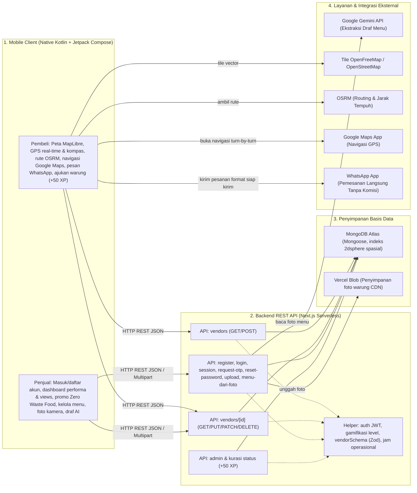
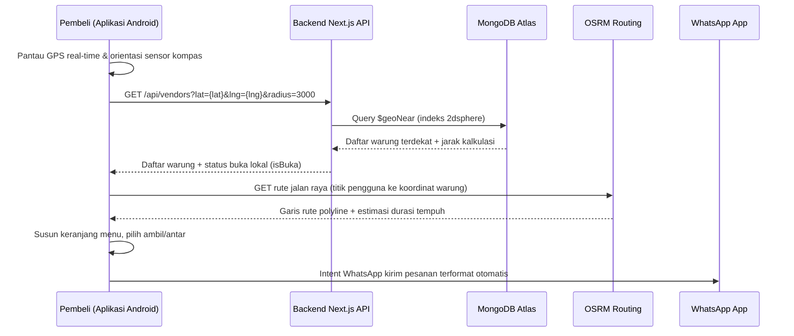
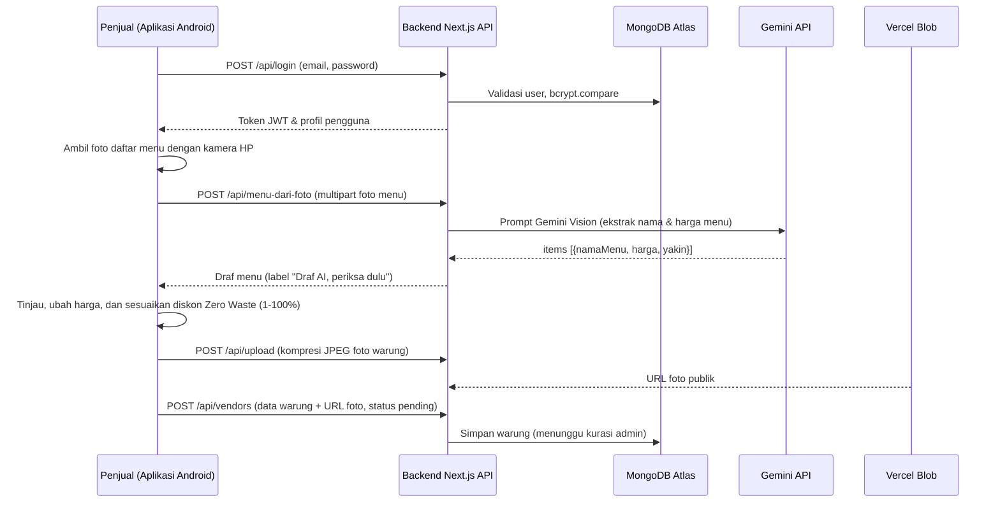

# Cari Jajan

Aplikasi mobile etalase hiperlokal UMKM — memudahkan pencarian warung UMKM terdekat di peta interaktif serta memfasilitasi promosi diskon *Zero Waste Food* agar makanan tidak mubazir bagi UMKM, bernavigasi langsung, dan memesan tanpa perantara lewat WhatsApp. Tanpa komisi, tanpa potongan merchant, dan tanpa pembayaran di dalam aplikasi.

> Kategori lomba: **Mobile Application** · Subtema: **Local MSME**

---

## Daftar Isi

1. [Tim & Pernyataan](#1-tim--pernyataan)
2. [Pengenalan Proyek (Latar Belakang, Solusi & Target Pengguna)](#2-pengenalan-proyek)
3. [Fitur Utama yang Sudah Berjalan](#3-fitur-utama-yang-sudah-berjalan)
4. [Technical Documentation (Arsitektur Sistem & Alur Program)](#4-technical-documentation)
5. [Frontend Documentation (Framework, Komponen UI & Aset)](#5-frontend-documentation)
6. [Backend Documentation (API Endpoints, Database Schema & Environment)](#6-backend-documentation)
7. [Petunjuk Instalasi Localhost (Langkah-demi-Langkah)](#7-petunjuk-instalasi-localhost)
8. [Akun Uji Coba Juri & Akun Demo](#8-akun-uji-coba-juri--akun-demo)
9. [Dokumentasi Penggunaan AI](#9-dokumentasi-penggunaan-ai)
10. [Etika, Keamanan & Atribusi](#10-etika-keamanan--atribusi)

---

## 1. Tim & Pernyataan

### a. Anggota Tim
- **Nama tim:** [nama team]
- **Anggota:**
  - Nico
  - Zam Zam
  - Farel
  - Iwan

### b. Pernyataan dan Komitmen
Kami yang bertanda tangan di bawah ini menyatakan dengan sebenar-benarnya, serta bertanggung jawab secara hukum dan akademik, bahwa:
1. **Orisinalitas dan Kepengarangan:** Karya yang diajukan merupakan hasil pemikiran, perancangan, dan pengembangan asli oleh penulis. Karya ini tidak menyalin, menjiplak, menerjemahkan, atau mengadaptasi karya pihak lain tanpa mencantumkan sumber secara tepat.
2. **Hak Kekayaan Intelektual:** Karya ini tidak melanggar hak cipta, paten, merek, rahasia dagang, maupun hak kepemilikan pihak lain. Seluruh literatur, gambar, kode, dan dataset yang digunakan telah dicantumkan sumbernya sesuai kaidah akademik.
3. **Eksklusivitas Pengajuan:** Karya ini belum pernah dipublikasikan dalam jurnal atau prosiding, tidak sedang dan belum pernah diikutsertakan, memperoleh penghargaan, atau dalam proses penilaian pada kompetisi nasional maupun internasional lainnya.
4. **Keaslian Data dan Temuan:** Data empiris, hasil eksperimen, tanggapan survei, kode, serta demonstrasi prototipe yang disertakan merupakan data dan hasil yang autentik, akurat, diperoleh secara etis, serta bebas dari fabrikasi dan falsifikasi.
5. **Penggunaan Kecerdasan Artifisial:** Penggunaan perangkat kecerdasan artifisial (AI) dalam penelitian atau penyusunan draf telah mematuhi ketentuan resmi kompetisi dan diungkapkan secara transparan. Gagasan inti, analisis kritis, dan keluaran intelektual tetap merupakan hasil karya manusia.
6. **Konsekuensi Pelanggaran:** Kami memahami bahwa pelanggaran terhadap pernyataan ini dapat mengakibatkan diskualifikasi, pencabutan penghargaan atau sertifikat, serta pelaporan kepada universitas untuk proses penegakan disiplin akademik.
7. **Kepatuhan Alur Kompetisi:** Kami bersedia mengikuti alur kompetisi yang diberikan oleh panitia dari awal hingga akhir kompetisi.

---

## 2. Pengenalan Proyek

### a. Identitas Proyek
| Parameter | Informasi |
|---|---|
| **Kategori Lomba** | Mobile Application |
| **Nama Aplikasi** | Cari Jajan |
| **Platform Klien** | Android (100% Native Kotlin + Jetpack Compose) |
| **Tautan Berkas APK (GitHub Release)** | [Unduh APK Cari Jajan v1.0.0](https://github.com/nikd7690-ops/web-cari-jajan/releases/download/v1.0.0/cari-jajan-v1.0.0.apk) |
| **Tautan Backend API Produksi** | [https://web-cari-jajan.vercel.app](https://web-cari-jajan.vercel.app) |
| **Target Pengguna** | Pelaku UMKM mikro kuliner (warung makan, pedagang kaki lima/PKL, penjual keliling) dan masyarakat pembeli/kontributor kuliner lokal di lingkungan sekitar |

### b. Latar Belakang Masalah
1. **Keterbatasan Visibilitas Digital & Potongan Komisi Merchant:** UMKM mikro — seperti warung rumahan, pedagang kaki lima (PKL), dan pedagang keliling — sangat sulit ditemukan oleh pembeli di lingkungan sekitarnya karena keterbatasan visibilitas digital. Tidak tersedianya etalase katalog menu digital yang praktis dan mahalnya potongan komisi merchant di aplikasi pesan-antar besar (mencapai 20% – 30%) menjadi beban berat bagi pedagang kecil dan menaikkan harga beli bagi konsumen lokal.
2. **Tingginya Makanan Mubazir & Kerugian Finansial (*Food Waste* UMKM):** Pelaku usaha kuliner mikro kerap menghadapi sisa porsi makanan layak konsumsi yang belum habis terjual menjelang jam tutup warung. Tanpa adanya saluran promosi cepat langsung ke warga sekitar, makanan segar tersebut terancam terbuang sia-sia (*mubazir*), menimbulkan kerugian modal bahan baku bagi penjual serta menyumbang timbunan limbah makanan (*food waste*) bagi lingkungan.

### c. Gambaran Solusi
Cari Jajan hadir sebagai solusi aplikasi mobile (*native Android*) yang menghubungkan pembeli langsung dengan UMKM terdekat melalui peta interaktif berbasis OpenFreeMap dan GPS. Pembeli dapat menjelajah warung terdekat, melihat katalog menu dengan harga asli, mendapatkan navigasi rute turn-by-turn langsung ke lokasi, serta menyusun pesanan yang diteruskan langsung ke WhatsApp penjual tanpa perantara dan tanpa potongan komisi sepeser pun.

Aplikasi mengintegrasikan fitur gerakan **Zero Waste Food** (mendukung sasaran SDG 12: *Responsible Consumption and Production*) yang memudahkan penjual maupun kontributor mengaktifkan promo diskon porsi makanan jelang tutup secara fleksibel (mulai dari 1% hingga 100%) agar dagangan laris dan makanan tidak terbuang mubazir. Fitur ini dilengkapi pop-up label diskon interaktif yang melayang di atas pin peta dan bergerak harmonis mengikuti navigasi pembeli, serta didukung sistem gamifikasi kontributor (XP dan level) untuk mendorong pemetaan UMKM berbasis partisipasi warga sekitar.

---

## 3. Fitur Utama yang Sudah Berjalan

### A. Pembeli & Kontributor Komunitas
- **Deteksi Lokasi & Pencarian Terdekat:** Deteksi GPS real-time dengan kompas arah hadap perangkat. Bila GPS tidak aktif, tersedia pilihan kawasan manual.
- **Peta Interaktif Presisi:** Peta vektor modern (MapLibre Native Android + OpenFreeMap Liberty) dengan marker kategori warung kustom (rumah makan, gerobak PKL, motor keliling, warung tetap) yang ikonnya konsisten dengan profil warung.
- **Pop-Up Foto Warung & Diskon di Peta:** Saat pin diklik di peta, foto warung dan label diskon mekar mengambang persis di atas pin dan ikut bergeser secara alami saat peta digeser. Kalibrasi jangkar (*anchor*) presisi memastikan ujung panah pin selalu menancap tepat di koordinat GPS warung tanpa meleset.
- **Filter Waktu Operasional:** Tombol filter waktu berbasis icon kit resmi (Semua, Pagi, Siang, Malam) dengan status buka/tutup akurat sesuai zona waktu lokal (WIB GMT+7).
- **Rute & Navigasi GPS Turn-by-Turn:** Kalkulasi jalur jalan raya riil via OSRM, estimasi durasi (motor & jalan kaki), serta tombol navigasi langsung ke Google Maps dengan panduan suara.
- **Pencarian & Filter Kategori:** Filter chip warung (Semua, Warung, PKL, Rumah Makan, Cafe, Keliling) dan live search bar.
- **Daftar Warung Terdekat:** Menampilkan warung terdekat dalam radius dengan penanda status Buka/Tutup dan jarak riil.
- **Halaman Detail Warung & Pesanan WhatsApp:** Katalog menu dengan kalkulasi harga promo otomatis saat ada diskon (harga asli dicoret dan badge diskon tertera jelas), opsi pesan diantar / ambil sendiri, serta tautan langsung ke WhatsApp penjual tanpa potongan komisi.
- **Kontribusi Titik Warung Baru (Crowdsourced):** Pembeli dapat mengajukan titik lokasi warung UMKM tersembunyi yang baru mereka temukan untuk dikurasi admin, termasuk menginfokan jika warung sedang mengadakan diskon/promo.
- **Gamifikasi Kontributor (Level & XP):** Sistem reward +50 XP per warung yang lolos kurasi admin, progress bar XP, dan gelar kehormatan kontributor (*Penjelajah Jajanan*, *Pemberi Rekomendasi*, *Pahlawan UMKM Lokal*).

### B. Pemilik Warung (Penjual)
- **Pendaftaran & Autentikasi Mandiri:** Masuk, buat akun, dan pemulihan akun cepat lewat fitur "Lupa Password" dengan verifikasi kode OTP 6-digit, validasi Zod ketat, dan enkripsi password bcrypt (salt 10).
- **Dashboard Performa Warung:**
  - **Statistik Pengunjung Real-Time:** Menampilkan total berapa kali warung dilihat oleh pembeli (*view count*) yang tercatat dan terakumulasi secara nyata di database setiap kali pembeli membuka halaman warung.
  - **Tanda Diskon Aktif:** Indikator visual mencolok pada kartu warung di dashboard saat pemilik warung sedang menyalakan promo potongan harga.
  - **Status Kurasi Admin:** Tampilan status verifikasi awal (*Menunggu Kurasi Admin* atau *Terverifikasi & Tayang*).
- **Fitur Khusus "Zero Waste Food" Fleksibel (1% – 100%):**
  - Sesuai pilar SDG 12 (*Responsible Consumption*), penjual (maupun pembeli yang mendaftarkan) dapat mengaktifkan promo diskon porsi makanan jelang tutup secara fleksibel mulai dari **1% hingga 100%** dengan slider dan preset cepat (-1%, -10%, -20%, -30%, -50%) agar dagangan laris dan mencegah makanan mubazir.
- **Pembaruan Seketika Tanpa Kurasi Ulang:** Perubahan daftar menu, harga makanan, ketersediaan menu, dan promo diskon langsung aktif seketika di aplikasi tanpa harus menunggu persetujuan ulang kurator admin.
- **Pengelolaan Warung & Menu:** Menambah, mengedit nama, patokan alamat, jam buka-tutup, nomor WhatsApp, foto, dan daftar menu dinamis.
- **Draf Menu dari AI:** Tombol "Baca menu dari foto" berbasis AI (Google Gemini API) untuk mengekstrak menu dan harga dari foto daftar menu secara otomatis dengan label wajib *"Draf AI, periksa dulu"*.
- **Keamanan Data Server-Side:** Validasi kepemilikan warung ketat di server; penjual hanya bisa mengubah warung miliknya sendiri.

### C. Kurasi & Admin
- **Halaman & Dashboard Kurasi Admin:** Tinjauan warung baru yang didaftarkan penjual maupun diajukan pembeli sebelum ditayangkan ke publik, lengkap dengan filter status (*Menunggu Kurasi*, *Tayang*, *Ditolak*).
- **Aksi Persetujuan & Penolakan:** Admin dapat menyetujui (*approve*) atau menolak (*reject*) warung dengan satu sentuhan.
- **Distribusi XP Otomatis:** Pemberian +50 XP secara otomatis ke akun pengaju saat warung disetujui (*approved*).
- **Penghapusan Warung Permanen:** Hak akses khusus admin untuk menghapus warung yang tidak valid atau melanggar ketentuan.
- **Manajemen Member & Leaderboard Kontributor:** Admin dapat memantau daftar member, melihat kontributor teraktif pengaju warung, serta menangguhkan/memblokir (*ban*) atau menghapus akun yang melanggar ketentuan komunitas.

---

## 4. Technical Documentation

### a. Diagram Arsitektur Sistem 4 Lapisan



### b. Diagram Alur Program: Pembeli (Pencarian, Navigasi & Pemesanan)



### c. Diagram Alur Program: Penjual (Autentikasi, Draf Menu AI, & Promosi)



---

## 5. Frontend Documentation

### a. Framework & Arsitektur Klien
- **Klien Mobile Utama (100% Native Android):**
  - **Bahasa & SDK:** Kotlin 2.0 murni, target Android SDK 37 (kompatibel mulai Android 8.0 Oreo / API 26+).
  - **UI Toolkit:** Jetpack Compose (Declarative UI) dengan standar **Material Design 3 (Compose Material3)**.
  - **Asynchronous & State Management:** Kotlin Coroutines & StateFlow untuk reaktivitas UI instan tanpa jank (60 FPS stabil).
  - **Jaringan & Serialisasi:** Retrofit 2 + OkHttp 3 dengan `kotlinx.serialization.json`.
- **Portal Web Pendukung:**
  - **Framework:** Next.js 16 (App Router), React 19, Tailwind CSS v4 untuk portal responsif web.

### b. Struktur Komponen UI Mobile (`native-android/app/src/main/java/com/carijajan/app/`)
| Komponen Layar / Modul | Berkas Sumber | Fungsi & Peran |
|---|---|---|
| **BerandaScreen** | `ui/screen/BerandaScreen.kt` | Layar utama eksplorasi peta interaktif, integrasi chip kategori warung, filter waktu operasional, dan bottom sheet daftar warung terdekat. |
| **WarungDetailScreen** | `ui/screen/WarungDetailScreen.kt` | Detail profil warung, display harga tercoret saat diskon, katalog menu, keranjang pesanan, dan direct intent pemesanan WhatsApp. |
| **DashboardScreen** | `ui/screen/DashboardScreen.kt` | Dashboard performa penjual (counter *views* pengunjung riil), pengaturan slider diskon Zero Waste (1%–100%), serta tab kurasi admin. |
| **MasukScreen** | `ui/screen/MasukScreen.kt` | Form autentikasi penjual/pembeli dan dialog 2 langkah pemulihan akun Lupa Password berbasis verifikasi OTP 6 digit. |
| **DaftarScreen** | `ui/screen/DaftarScreen.kt` | Form registrasi akun pengguna baru dengan pemilihan peran awal. |
| **EditWarungScreen** | `ui/screen/EditWarungScreen.kt` | Formulir tambah/edit warung, integrasi kamera foto, pembaca draf menu AI Gemini, dan geocoding koordinat GPS. |
| **PetaWarung** | `ui/components/PetaWarung.kt` | Pembungkus native MapLibre Android SDK dengan rendering vector tile OpenFreeMap Liberty dan gestur multitouch mulus. |
| **PinGenerator** | `ui/components/PinGenerator.kt` | Komponen render marker geospasial dinamis (warung, PKL, rumah makan, keliling), pop-up foto mengambang di atas pin, dan heading puck kompas. |
| **CariJajanBottomBar** | `ui/components/CariJajanBottomBar.kt` | Navigasi bawah modern yang stabil, responsif terhadap orientasi layar, dan terbebas dari overflow keyboard. |

### c. Design System & Manajemen Aset
- **Palet Warna Identitas Logo:**
  - `BrandOrange` (`#EA681E`): Warna primer aksi utama, tombol checkout, dan penanda pin aktif.
  - `BrandMaroon` (`#4A1517`): Warna sekunder untuk kontras tipografi judul, header, dan teks berbobot.
  - `BrandCream` (`#FFFBF7`): Latar belakang permukaan hangat dan bersih.
- **Mikro-Interaksi Pegas (*iOS-style Bounce*):**
  - Seluruh tombol interaktif, kartu warung, dan pin peta dilengkapi efek modifier `bounceEffect()` dan `bounceClick()` yang memberikan umpan balik taktil pegas responsif saat disentuh.
- **Ikonografi Vektor Kit Pack:**
  - Menghindari emoji generik platform yang tidak konsisten; seluruh ikon navigasi, status waktu (Pagi, Siang, Malam), dan kategori warung menggunakan ikon vektor resmi Material Design Icons & Android Vector Drawable (`.xml`).

---

## 6. Backend Documentation

### a. Database Schema (Mongoose Models MongoDB Atlas)

#### 1. Koleksi Pengguna (`UserSchema` — `models/User.js`)
| Nama Field | Tipe Data | Wajib | Keterangan & Batasan |
|---|---|:---:|---|
| `name` | `String` | Ya | Nama lengkap pengguna atau nama pemilik warung (trim). |
| `email` | `String` | Ya | Alamat email unik (*unique index*, lowercase, format valid). |
| `passwordHash` | `String` | Ya | Kata sandi terenkripsi algoritma `bcryptjs` (salt rounds 10). |
| `role` | `String` | Ya | Hak akses: `"user"` (pengguna umum/mitra) atau `"admin"` (kurator platform). Indexing aktif. |
| `tipeAkun` | `String` | Ya | Peran operasional: `"pengguna"` (pembeli/kontributor) atau `"mitra"` (pemilik warung). |
| `xp` | `Number` | Tidak | Total perolehan XP gamifikasi kontributor (default: 0, min: 0). |
| `level` | `Number` | Tidak | Level kontributor (Level 1, 2, atau 3). |
| `isBanned` | `Boolean` | Tidak | Status penangguhan akun oleh moderator admin (default: `false`). |
| `bannedAt` | `Date` | Tidak | Waktu akun ditangguhkan (default: `null`). |
| `bannedReason`| `String` | Tidak | Alasan penangguhan akun. |
| `otpCode` | `String` | Tidak | Kode verifikasi numerik 6 digit untuk pemulihan kata sandi (default: `null`). |
| `otpExpiresAt`| `Date` | Tidak | Masa berlaku kode OTP (10 menit sejak permintaan). |
| `createdAt` | `Date` | Tidak | Timestamp pendaftaran akun (default: `Date.now`). |

#### 2. Koleksi Warung UMKM (`VendorSchema` — `models/Vendor.js`)
| Nama Field | Tipe Data | Wajib | Keterangan & Batasan |
|---|---|:---:|---|
| `owner` | `ObjectId (User)`| Tidak | Referensi ID akun pemilik warung terverifikasi (default: `null`). |
| `submittedBy` | `ObjectId (User)`| Ya | Referensi ID akun pengguna yang mendaftarkan/mengajukan warung. |
| `status` | `String` | Ya | Status kurasi: `"pending"`, `"approved"`, atau `"rejected"`. Indexing aktif. |
| `namaToko` | `String` | Ya | Nama resmi warung / pedagang UMKM. |
| `kategori` | `String` | Ya | Kategori pedagang: `"warung"`, `"pkl"`, `"rumah_makan"`, atau `"keliling"`. |
| `lokasi` | `GeoJSON Point` | Ya | Format: `{ type: "Point", coordinates: [lng, lat] }`. **Indeks spasial 2dsphere**. |
| `alamatPatokan`| `String` | Ya | Alamat deskriptif atau patokan fisik terdekat lokasi warung. |
| `jamBuka` | `String` | Ya | Format jam buka 24-jam (`HH:mm`, regex: `/^([01]\d|2[0-3]):[0-5]\d$/`). |
| `jamTutup` | `String` | Ya | Format jam tutup 24-jam (`HH:mm`). |
| `nomorWA` | `String` | Tidak | Nomor kontak WhatsApp aktif pedagang untuk pesanan langsung. |
| `layananAntar` | `Boolean` | Tidak | Opsi melayani antar pesanan ke alamat pembeli (default: `false`). |
| `foto` | `String` | Tidak | URL publik berkas foto warung di Vercel Blob Storage. |
| `menus` | `[MenuSchema]` | Tidak | Daftar menu: `namaMenu` (String), `harga` (Number >= 0), `tersedia` (Boolean). |
| `views` | `Number` | Tidak | Total counter jumlah warung dilihat pembeli (default: 0). |
| `zeroWaste` | `Object` | Tidak | Pengaturan diskon: `aktif` (Boolean), `diskonPersen` (1–100%), `keterangan` (String). |
| `createdAt` | `Date` | Auto | Waktu data dibuat (*timestamps: true*). |
| `updatedAt` | `Date` | Auto | Waktu pembaruan data terakhir (*timestamps: true*). |

**Indeks Database MongoDB:**
- `VendorSchema.index({ lokasi: "2dsphere" })` — Memungkinkan pencarian radius spasial `$geoNear` berkecepatan tinggi tanpa pemindaian penuh seluruh dokumen.
- `VendorSchema.index({ status: 1, createdAt: -1 })` — Optimasi query penyaringan warung tayang dan antrean kurasi admin.

---

### b. Referensi API Endpoints (REST API)

Semua endpoint menerima dan mengembalikan format data JSON (kecuali upload berkas multipart).

| Metode | Path Endpoint | Hak Akses | Deskripsi & Validasi |
|---|---|---|---|
| **GET** | `/api/vendors` | Publik | Query warung terdekat via `$geoNear`; parameter `lat`, `lng`, `radius` (meter, default 2000, maks 10000). |
| **POST** | `/api/vendors` | Login | Mendaftarkan warung baru (status awal `pending` menunggu kurasi), `submittedBy` otomatis dari JWT. |
| **GET** | `/api/vendors/[id]` | Publik | Detail lengkap satu warung beserta menu, status buka/tutup, dan promo Zero Waste. Menambah counter `views`. |
| **PUT** | `/api/vendors/[id]` | Login + Pemilik | Memperbarui seluruh informasi warung, menu, atau promo diskon secara mandiri. |
| **PATCH** | `/api/vendors/[id]` | Login + Pemilik | Memperbarui sebagian data warung (misal: toggle aktif diskon Zero Waste Food). |
| **DELETE** | `/api/vendors/[id]` | Login + Pemilik | Menghapus warung milik sendiri. |
| **GET** | `/api/vendors/mine` | Login | Menampilkan daftar warung yang dimiliki atau diajukan oleh pengguna yang sedang login. |
| **POST** | `/api/register` | Publik | Pendaftaran akun baru (nama, email, password), divalidasi Zod dan password di-hash bcrypt. |
| **POST** | `/api/login` | Publik | Masuk dengan email & password; mengembalikan token JWT dan profil sesi pengguna. |
| **POST** | `/api/auth/request-otp` | Publik | Meminta kode verifikasi OTP 6-digit untuk pemulihan akun (berlaku 10 menit). |
| **POST** | `/api/auth/reset-password` | Publik | Atur ulang kata sandi dengan verifikasi kode OTP 6-digit; password baru di-hash bcrypt. |
| **GET** | `/api/session` | Login | Mengambil data sesi profil aktif, poin XP, dan level gamifikasi pengguna. |
| **POST** | `/api/upload` | Login | Unggah foto warung (multipart form-data, kompresi JPEG, batas 2 MB) ke Vercel Blob. |
| **POST** | `/api/menu-dari-foto` | Login | Ekstraksi draf daftar menu dan harga dari foto via Google Gemini API dengan rate limiting. |
| **GET** | `/api/admin/vendors` | Admin | Menampilkan daftar seluruh warung untuk antrean kurasi verifikasi admin. |
| **PATCH** | `/api/admin/vendors/[id]` | Admin | Setujui (*approve*) atau tolak (*reject*) warung; otomatis menambahkan +50 XP ke pengaju. |
| **DELETE** | `/api/admin/vendors/[id]` | Admin | Menghapus warung secara permanen dari basis data oleh kurator admin. |
| **GET** | `/api/admin/members` | Admin | Menampilkan daftar anggota/member beserta leaderboard top kontributor pengaju warung. |
| **POST** | `/api/admin/members/[id]/ban`| Admin | Menangguhkan atau memulihkan status penangguhan (*ban/unban*) akun pengguna. |
| **DELETE** | `/api/admin/members/[id]` | Admin | Menghapus akun pengguna yang melanggar pedoman komunitas. |
| **POST** | `/api/reports` | Publik / Login | Mengirimkan laporan komunitas terkait ketidaksesuaian data atau penutupan warung. |
| **GET** | `/api/reports` | Admin | Meninjau laporan komunitas yang masuk untuk tindakan moderasi. |

---

### c. Variabel Lingkungan (`.env.example`)

Seluruh kredensial rahasia disimpan di file `.env.local` di tingkat server dan tidak pernah di-commit ke repositori:

```env
# Koneksi Database
MONGODB_URI=mongodb+srv://<user>:<password>@cluster0.mongodb.net/carijajan?retryWrites=true&w=majority

# Autentikasi NextAuth JWT
NEXTAUTH_SECRET=buat_string_acak_panjang_untuk_jwt_secret
NEXTAUTH_URL=http://localhost:3000

# Integrasi Google Gemini API
GEMINI_API_KEY=kunci_rahasia_gemini_api
GEMINI_MODEL=gemini-1.5-flash

# Penyimpanan Foto Cloud (Vercel Blob)
BLOB_READ_WRITE_TOKEN=vercel_blob_rw_token

# Konfigurasi Akun Demo Bawaan
DEMO_EMAIL=demo@carijajan.local
DEMO_PASSWORD=Demo1234!

# Tile Peta Vektor Geospasial
NEXT_PUBLIC_MAP_STYLE_URL=https://tiles.openfreemap.org/styles/liberty
```

---

## 7. Petunjuk Instalasi Localhost

Ikuti langkah-demi-langkah berikut untuk menjalankan proyek **Cari Jajan** di laptop/lingkungan lokal:

### Prasyarat Sistem:
- **Node.js:** Versi 20.x atau lebih baru (unduh dari [nodejs.org](https://nodejs.org/)).
- **Git:** Terpasang di sistem.
- **Java Development Kit (JDK):** JDK 17 (diperlukan hanya jika ingin mengompilasi aplikasi Android dari sumber).
- **Koneksi Database:** Instance MongoDB Atlas (atau MongoDB lokal pada `mongodb://localhost:27017/carijajan`).

---

### Langkah 1: Clone Repositori
Buka terminal dan unduh kode sumber proyek:
```bash
git clone https://github.com/nikd7690-ops/web-cari-jajan.git
cd web-cari-jajan
```

### Langkah 2: Instalasi Dependencies Backend & Web
Pasang seluruh pustaka paket Node.js yang diperlukan:
```bash
npm install
```

### Langkah 3: Konfigurasi File Environment
Salin berkas template environment:
```bash
cp .env.example .env.local
```
Buka file `.env.local` dengan editor teks dan isi minimal variabel `MONGODB_URI` dan `NEXTAUTH_SECRET` (bisa diisi string acak bebas untuk pengujian lokal).

### Langkah 4: Pengisian Data Awal (Seeding Akun Juri)
Jalankan skrip seed otomatis untuk mengisi database dengan akun juri dan warung contoh:
```bash
npm run seed:juri
```
*(Skrip ini otomatis membuat akun Member, Mitra Warung dengan promo Zero Waste 35%, dan Akun Admin Kurator).*

### Langkah 5: Menjalankan Server Web & Backend API
Jalankan server pengembangan:
```bash
npm run dev
```
Buka peramban (browser) di alamat: **`http://localhost:3000`**. REST API backend kini aktif dan melayani endpoint pada rute `/api/*`.

### Langkah 6: Menjalankan Pengujian Unit Otomatis (Vitest)
Untuk memastikan seluruh logika kalkulasi jam buka, validasi Zod, formula diskon, dan hashing bcrypt berfungsi 100%:
```bash
npm test
```
*(Seluruh 58 tes unit akan dieksekusi dan dilaporkan lulus).*

### Langkah 7: Menjalankan Aplikasi Mobile Native Android

#### Opsi A: Langsung Menggunakan Berkas APK Siap Pakai (Rekomendasi untuk Juri)
1. Unduh berkas APK rilis resmi: [cari-jajan-v1.0.0.apk](https://github.com/nikd7690-ops/web-cari-jajan/releases/download/v1.0.0/cari-jajan-v1.0.0.apk)
2. Pasang langsung di ponsel Android fisik Anda atau seret (*drag-and-drop*) ke emulator Android Studio.

#### Opsi B: Mengompilasi Kode Sumber Android dari Terminal
1. Hubungkan HP Android fisik (dengan USB Debugging aktif) atau nyalakan Android Emulator.
2. Jalankan build dan instalasi otomatis via Gradle:
   ```bash
   cd native-android
   ./gradlew installDebug
   ```
   *(Pada sistem Windows gunakan `gradlew.bat installDebug`)*.
3. Aplikasi **Cari Jajan** akan terpasang dan siap digunakan secara penuh.

---

## 8. Akun Uji Coba Juri & Akun Demo

Untuk mempermudah pengujian dan penilaian langsung oleh dewan juri, telah disediakan 3 akun terkonfigurasi dengan peran spesifik:

| Peran Akun | Alamat Email | Kata Sandi | Hak Akses & Status Data Awal |
|---|---|---|---|
| **Member (Pembeli & Kontributor)** | `member@gmail.com` | `password123` | Level 2 (150 XP), riwayat pengaju warung terverifikasi, dapat menjelajah peta, bernavigasi, memesan WhatsApp, serta mengajukan warung baru beserta info diskon. |
| **Mitra (Pemilik Warung)** | `pemilikwarung@gmail.com` | `password123` | Pemilik resmi "Warung Bu Siti", akses dashboard performa warung, counter views pengunjung, kelola menu, dan promo aktif Zero Waste Food diskon 35%. |
| **Administrator (Kurator)** | `admin@gmail.com` | `password123` | Akses penuh dashboard admin, kurasi persetujuan/penolakan warung baru, hapus warung permanen, leaderboard pengaju, dan moderasi ban/unban member. |

> **Catatan Pengujian Juri:** Seluruh akun di atas dapat di-reset atau diisi ulang sewaktu-waktu dengan menjalankan perintah `npm run seed:juri` di terminal.
>
> Tersedia juga akun demo bawaan:
> - **Email:** `demo@carijajan.local`
> - **Password:** `Demo1234!` (dapat diisi ulang via `npm run seed`)

---

## 9. Dokumentasi Penggunaan AI

### a. Integrasi AI di Dalam Produk
- **Layanan & Model:** Google Gemini API (model `gemini-1.5-flash`, nama model dikonfigurasi melalui variabel environment `GEMINI_MODEL`).
- **Fitur Produk:** Fitur *"Baca menu dari foto"* pada formulir tambah/edit warung (`POST /api/menu-dari-foto`). Server mengirimkan citra gambar daftar menu ke Gemini Vision dan menerima struktur JSON terstandarisasi `{ items: [{ namaMenu, harga, yakin }] }`.
- **Etika & Pengawasan Manusia (*Human-in-the-Loop*):**
  - Model diinstruksikan hanya mengekstrak teks yang terlihat secara faktual dan dilarang menebak harga.
  - Hasil AI selalu diberi label tegas: **"Draf AI, periksa dulu"**. Draf tidak pernah disimpan ke database tanpa pemeriksaan manual, koreksi, dan persetujuan eksplisit dari pemilik warung.
  - Berkas gambar sementara segera dibersihkan dari server demi menjaga privasi pengguna.
  - Diterapkan mekanisme pembatasan laju (*rate limiting*) untuk mencegah penyalahgunaan API.

### b. Asisten Coding AI Selama Pengembangan
- **Alat Bantu:** **OpenCode** dan **Google Antigravity** (dengan model Gemini 3.8 Flash High) dimanfaatkan secara transparan sebagai *coding assistant* untuk scaffolding arsitektur, refaktorisasi komponen Jetpack Compose, penyusunan tes unit Vitest, pembuatan draf dokumentasi, serta integrasi MapLibre Native SDK. Seluruh keputusan desain arsitektur, logika bisnis, dan kepengarangan tetap sepenuhnya di bawah kendali dan arahan pengembang manusia.

---

## 10. Etika, Keamanan & Atribusi

### a. Etika dan Keamanan Data
- **Data yang Disimpan:** Akun pengguna (nama, email, hash password bcrypt, tanggal dibuat, XP/Level), data warung (nama, kategori, koordinat spasial GeoJSON, patokan alamat, jam operasional, nomor WhatsApp, daftar menu), serta URL foto warung.
- **Data yang TIDAK Disimpan:** Lokasi GPS real-time pembeli (hanya diproses di memori perangkat klien), riwayat isi keranjang belanja pembeli, dan citra berkas foto menu pembacaan AI.
- **Enkripsi Kata Sandi:** Selalu di-hash menggunakan `bcryptjs` dengan salt rounds 10; tidak pernah disimpan atau dicatat dalam bentuk teks asli (*plain text*).
- **Keamanan Kunci Rahasia:** Seluruh kunci API dan URI database diakses via `process.env.*` dan didaftarkan di `.env.example` tanpa nilai asli. Berkas `.env*` diabaikan oleh Git.
- **Validasi Berlapis Sisi Server:** Setiap masukan klien divalidasi menggunakan skema Zod di backend Next.js sebelum berinteraksi dengan basis data.
- **Kemandirian Finansial UMKM:** Nol persen komisi merchant dan tidak ada penahanan dana; transaksi berlangsung langsung antara pembeli dan penjual via WhatsApp.

### b. Atribusi Lisensi dan Pustaka Terbuka
- **Data Peta:** © kontributor [OpenStreetMap](https://www.openstreetmap.org/copyright) (lisensi Open Database License / ODbL). Atribusi wajib selalu ditampilkan pada peta.
- **Tile Peta Vektor:** [OpenFreeMap](https://openfreemap.org/) (Liberty Style)
- **Mesin Routing & Navigasi:** [OSRM (Open Source Routing Machine)](https://project-osrm.org/)
- **SDK Peta Mobile:** [MapLibre Native Android](https://maplibre.org/) — 3-Clause BSD License
- **Framework & Runtime:** [Next.js](https://nextjs.org/) (MIT) · [React](https://react.dev/) (MIT) · Android Jetpack (Apache-2.0)
- **Basis Data & ORM:** [MongoDB](https://www.mongodb.com/) · [Mongoose](https://mongoosejs.com/) (MIT)
- **Autentikasi & Keamanan:** [NextAuth.js](https://next-auth.js.org/) (ISC) · [bcryptjs](https://github.com/dcodeIO/bcrypt.js) (BSD-3-Clause)
- **Validasi Data:** [Zod](https://zod.dev/) (MIT)
- **Penyimpanan Objek:** [Vercel Blob](https://vercel.com/docs/storage/vercel-blob) (Apache-2.0)
- **Styling UI:** [Tailwind CSS](https://tailwindcss.com/) (MIT) · Material Design 3 (Apache-2.0)
- **Framework Pengujian:** [Vitest](https://vitest.dev/) (MIT)
